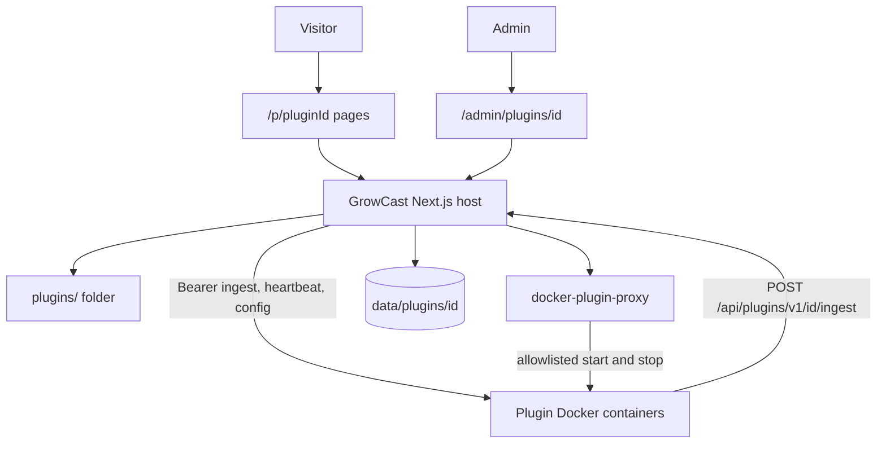
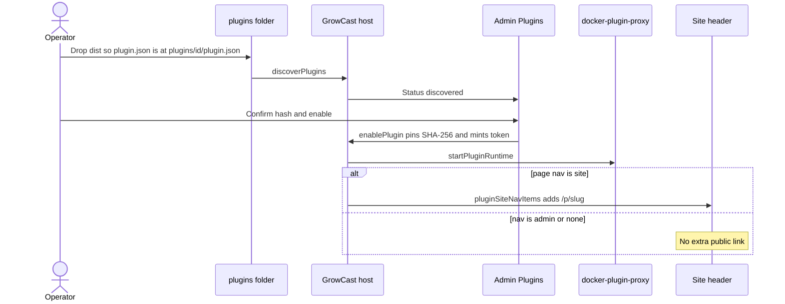
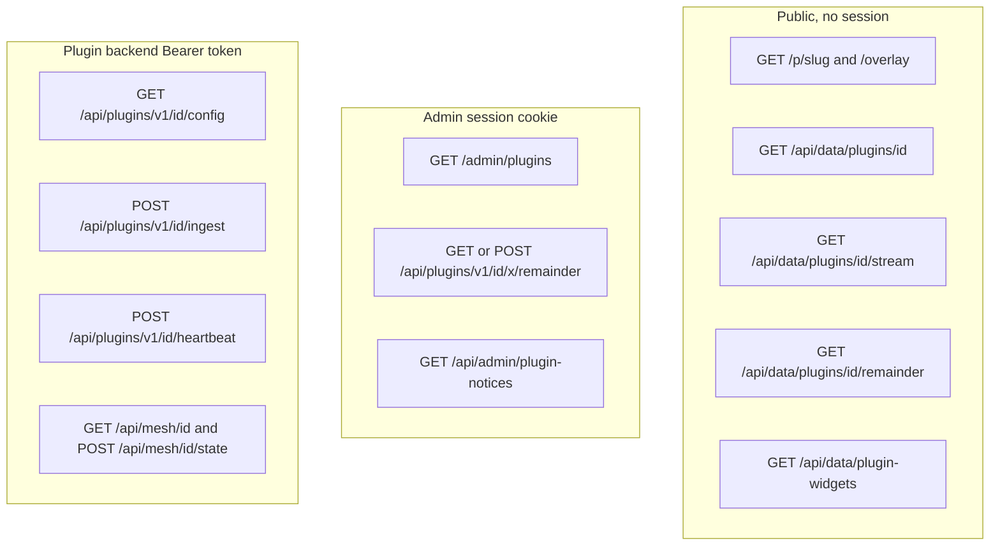

# GrowCast plugin system

## Quick install

1. Run GrowCast (`docker compose up --build -d`, then the setup wizard).
2. Drop a plugin **release dist** into `plugins/<folder>/` so `plugin.json` is at that path.
3. Open **Admin → Plugins**, confirm the hash, and enable. GrowCast starts the backend through `docker-plugin-proxy`.

A plugin is a folder in `plugins/` with `plugin.json`, an optional backend, and an optional `ui/dist` bundle. Core is the generic host: discovery, trusted install (SHA-256 pin), per-plugin tokens, ingest/heartbeat validation, storage under `data/plugins/<id>/`, generic routes, and compose generation. Core builds, tests, and runs with `plugins/` empty except [plugins/README.md](../../plugins/README.md).

The folder pin is the SHA-256 Admin shows at enable time. It covers every file the host can execute, plus the manifest:

- `plugin.json`
- `host/dist/**` (production `require`s `host/dist/index.js` first) and any other host entry such as `host/index.js` or `host/index.ts` when that file is what the loader runs
- `ui/dist/**`
- Dockerfiles, Python/Node backends, and the rest of the shipped folder

It does not cover `node_modules`, `.git` and other dot-directories, `__pycache__`, `*.pyc` / `*.pyo`, `snapshots/`, `timelapse/` media, `media/`, `coverage/`, `dist-info/`, or `dist-release/` (a local pack of a plugin release). `GROWCAST-HASH` is the recorded pin, not an input, so the file can match Admin. A change to a covered file, including a rebuilt `host/dist`, pauses an enabled plugin until you confirm the new hash. The cached check is size plus mtime of those same files.

GrowCast GGS is not in this repository. Its source is [GrowCast-GGS](https://github.com/zeroXmrcl/GrowCast-GGS), installed at `plugins/ggs/`. The host image does not scan that folder for Tailwind classes. GGS ships `ui/dist/style.css` and lists it in `plugin.json` `ui.styles`, so a bind-mounted checkout still styles the climate card. `app/globals.css` declares `@layer plugin` before the host Tailwind import. Plugin stylesheets put their utilities in that layer and do not ship a second theme or preflight, so a plugin sheet loaded after the host cannot restyle host layout, type, or images. Timelapse, Restream, and Solar copies are still in this branch under `plugins/{timelapse,restream,solar}` and will move to their own GitHub repos. Install a release dist with [INSTALL.md](./INSTALL.md).

- `growcast.ggs` — Spider Farmer climate and tent energy
- `growcast.timelapse` — snapshots and video
- `growcast.restream` — Twitch program capture
- `growcast.solar` — FENECON / vendor-agnostic solar split (Live / 24H / 7D / 30D / This Grow, tent-first view, dashboard and overlay widgets)

Open **Admin → Plugins**, read the warning, confirm the hash, enable. First-party plugins are **not** auto-enabled. GrowCast starts the backend through `docker-plugin-proxy` (never a raw `docker.sock` mount). If files change, the plugin is paused until the new hash is confirmed. See [DOCKER-PROXY.md](./DOCKER-PROXY.md).

Plugin pages live under `/p/<plugin>/...`. Admin pages under `/admin/plugins/<id>/...`. Core routes always win.

A site header link appears only when the plugin is **installed**, **enabled**, and a page declares `nav: "site"` (`lib/plugins/nav.ts` `pluginSiteNavItems`). `nav: "none"` pages (program, capture, Solar widgets) do not get a public header item.

Widget UI is built to `plugins/*/ui/dist` (`npm run build:plugin-ui`) and loaded through the host import map. The frontend SDK (`packages/plugin-sdk`, MIT) shares core React 19. The Python SDK (`packages/plugin-sdk-python`, MIT) posts ingest and heartbeats.

See [MIGRATION.md](./MIGRATION.md) and [HOST-API.md](./HOST-API.md).

## Architecture

## Plugin lifecycle

## Host API endpoints

| Method | Path | Auth | public/admin | Purpose |
|--------|------|------|----------|---------|
| GET | `/p/:pluginId/…` | none, unless the page sets `public: false` | public or admin | Plugin UI from `plugin.json` `pages` |
| GET | `/admin/plugins` | admin session | admin | Trusted install list |
| GET | `/admin/plugins/:pluginId/…` | admin session | admin | Plugin admin UI |
| GET | `/api/data/plugins/:id` | none | public | Live metrics/state |
| GET | `/api/data/plugins/:id/stream` | none | public | Live SSE |
| GET | `/api/data/plugins/:id/:path` | none | public | `handlePublic` dispatch |
| GET | `/api/data/plugin-widgets?slot=` | none | public | Widget entries for a slot |
| GET | `/api/plugins/v1/:id/config` | plugin Bearer | backend | Config including secrets |
| POST | `/api/plugins/v1/:id/ingest` | plugin Bearer | backend | Metrics + state |
| POST | `/api/plugins/v1/:id/heartbeat` | plugin Bearer | backend | Liveness |
| GET, POST | `/api/plugins/v1/:id/x/:path` | admin session | admin | `handleAction` proxy |
| GET | `/api/mesh/:id` | mesh Bearer | sidecar | Legacy mesh settings |
| POST | `/api/mesh/:id/state` | mesh Bearer | sidecar | Legacy mesh state ingest |
| GET | `/api/admin/plugin-notices` | admin session | admin | Admin toasts after login |
