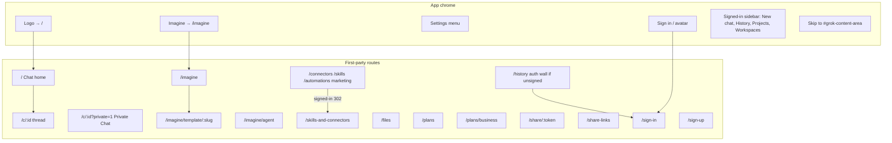
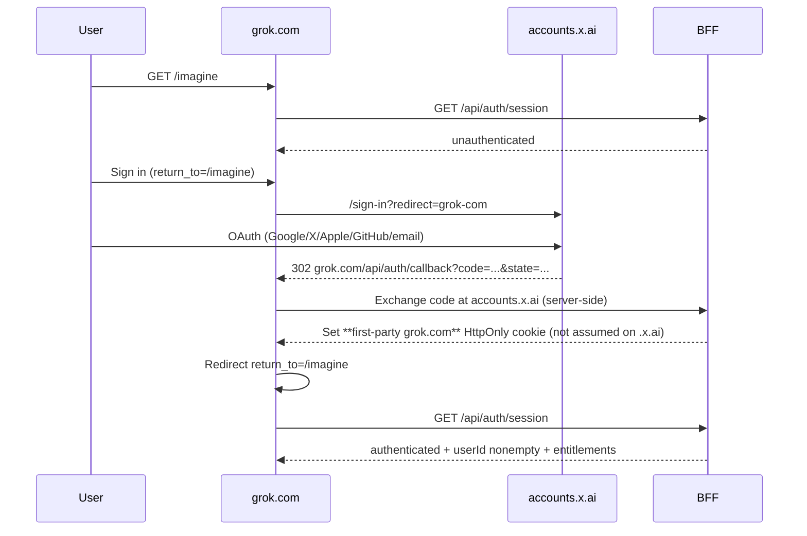
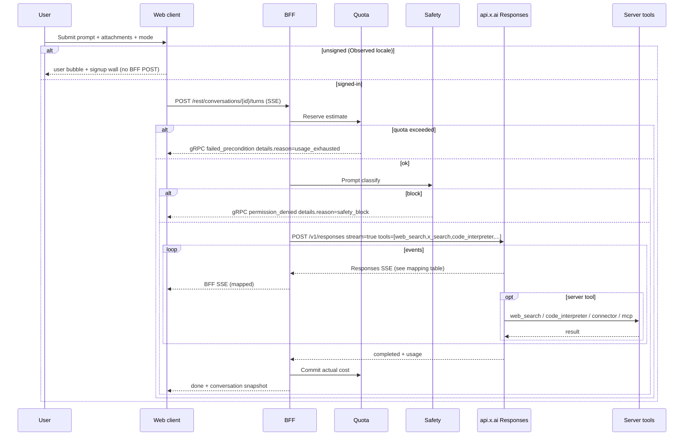
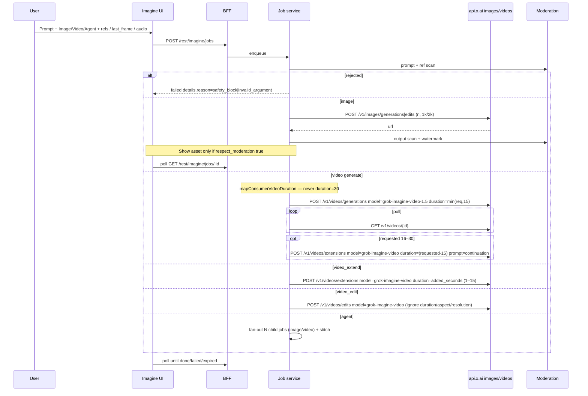
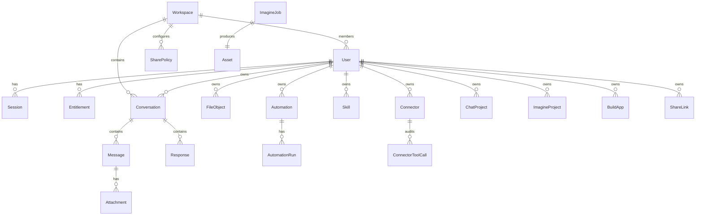

# Grok Dash — grok.com Product & System Design

| Field | Value |
| --- | --- |
| **Title** | Grok Dash: signed-in grok.com application shell and first-party surfaces |
| **Author** | Grok Design |
| **Date** | 2026-09-18 |
| **Status** | Draft |
| **Audience** | Designers and engineers using grok.com as **UI / motion-UI inspiration** for a different web app; reconstruction appendix for anyone who later implements grok.com-like behavior |
| **Primary source of truth** | Live site [https://grok.com/](https://grok.com/) as of 2026-09-18, plus public xAI docs, news, and legal pages |
| **How to use this document** | **Primary:** chrome, layout, motion, empty/loading/error, signed-out vs signed-in IA, component regions (**Visual / UX system** + **Major views**). **Secondary / reconstruction appendix:** BFF, quota, auth, security, PR slices — complete enough to reconstruct grok.com, **not** a build mandate for the inspiration app. The inspiration app does **not** need real billing, guest-inference geos, SKU math, or webhook plan gates. |
| **Workspace note** | This document is **not** a GrowCast design and is **not** a plan to ship grok.com itself. |

**Evidence legend.** Every claim is tagged:

- **Observed** — verified on live grok.com / accounts.x.ai in a signed-out browser on 2026-09-18.
- **Documented** — stated in public xAI docs, news, pricing, or legal pages.
- **Specified** — implementation contract chosen in this spec so an engineer can build. Not claimed as leaked private xAI infra.
- **Assumption** — reasonable inference; must be validated with a product owner or by signing in.

Do not treat Specified or Assumption items as facts about xAI’s private monorepo.

---

## Overview

Grok Dash is the **grok.com web product**: a Next.js application that hosts xAI’s consumer (and Grok Business) assistant. It is the signed-in application shell plus every first-party surface it hosts — home/prompt, chat threads, Imagine, voice, file uploads, connectors, Skills, Automations, Build Mode, settings/account/subscription, search, model picker, and related chrome.

As of 2026-09-18 the live site is a **single-page-app-shaped Next.js app** (Observed: `cdn.grok.com/_next/static/chunks`, Turbopack chunk names, `#grok-app-root`, `#grok-content-area`). Identity lives on **accounts.x.ai**. Inference, Imagine, Voice, and Files are publicly documented at **api.x.ai**. Billing for web subscriptions is **Stripe** (Observed: `js.stripe.com` + `GET /rest/products?provider=SUBSCRIPTION_PROVIDER_STRIPE`). Consent is **OneTrust**. Analytics include **GTM-TBL6BD7W**, Cloudflare RUM, and `POST /monitoring`.

The problem this design solves: grok.com is a multimodal, quota-metered, cross-device assistant with a growing set of product modes (Chat, Imagine, Voice, Build, Connectors, Skills, Automations) that must share one account, one weekly usage pool, one conversation graph, and one safety stack — without collapsing into a single undifferentiated prompt box, and without exposing connector tokens, files, or generation jobs to the browser as raw secrets.

The proposed solution: a **thin Next.js client** + **TypeScript BFF** (`/rest/*`, `/api/auth/*`) that owns sessions, entitlements, conversation persistence, uploads, job orchestration, and connector token vaulting; plus **specialized backends** for streaming chat, Imagine jobs, voice realtime, and published Build apps on `grok.me`. The public xAI API (`api.x.ai`) is the inference substrate; grok.com is not the API console and is not Grok Bot.

**How to use this document (product owner, 2026-09-18).** This spec’s **primary job** is **UI / Motion-UI design**: chrome, layout, motion, empty/loading/error, signed-out vs signed-in information architecture, and component regions. It is later **inspiration for a different web app**, not a ship of grok.com. That app does **not** need to be fully functional (no real billing, guest-inference geos, SKU math, webhook plan gates). Start from **Visual / UX system** and **Major views**. Backend/BFF/quota/security/PR Plan remain as a **reconstruction appendix** — keep them; do not treat slices A–K as the inspiration build order.

**Reconstruction note.** Live **signed-in** chrome (sidebar, usage chip, files library, connector catalog, Build publish sheet, Settings tabs) was **not Observed** (no session). Those surfaces are Specified from public FAQ/news/docs. Unsigned behavior below was re-verified 2026-09-18 (`lang=de`).

---

## Background & Motivation

### Current state (2026-09-18)

**Documented** ([Welcome to Grok](https://docs.x.ai/grok/overview)): Grok is xAI’s assistant on grok.com, iOS, and Android. Sign in once; conversations, settings, and subscription sync across platforms. Surfaces: Chat, Imagine (image + video), voice, file uploads (PDF, images, spreadsheets, code, audio, and more), Connectors. Free to start; SuperGrok paid plans; one shared weekly usage allowance.

**Observed on signed-out grok.com:**

- Skip-to-content link targeting `#grok-content-area` (German locale in this session: “Zum Hauptinhalt springen”).
- Logo home `/`, Imagine `/imagine`, Sign in `/sign-in?return_to=%2F`, Sign up `/sign-up?return_to=%2F`.
- H1: “Was sollen wir erkunden?” / English equivalent “What should we explore?”
- Composer: multiline textbox, attach button, model picker, disabled submit until input.
- Model picker (from `#server-client-data-modes`): `fast` (default, `available`), plus `auto`, `expert` (“Denkt scharf nach · Grok 4.6”), `heavy` (“Expertenteam · Grok 4.6”), **`build`** (`title: Build`, `badgeText: Beta`, `description: Build apps and sites · Grok 4.6`, `iconHint: hammer`, `requiresUpgrade` when unsigned). Menu also has “Erweiterte Funktionen freischalten / Anmelden”.
- Composer accessible name is **`Ask Grok anything`** even when `lang=de` (not the German placeholder).
- Unsigned Fast **compose** works; **send does not infer**. Submitting `"hello"` inserts the user bubble then an in-thread wall **“Dein Gespräch fortsetzen”** / “Melde dich an, um nahtlos Groks volle Leistung zu nutzen” with **“Kostenlos registrieren”** (benefits: Imagine, Skills & Connectors, generated files, chat history). No assistant tokens, no `/c/:id` navigation. (Re-verified 2026-09-18, this locale.)
- Attach menu (unsigned): **Datei hochladen** / **Zum Projekt hinzufügen** / **Zuletzt verwendete Dateien**.
- Messaging footer agrees to [Terms](https://x.ai/legal/terms-of-service) and [Privacy](https://x.ai/legal/privacy-policy); “Your privacy choices”; OneTrust cookie dialog.
- Settings (unsigned): Light / Dark / System, Language, Feedback.
- Fonts: Universal Sans, Universal Sans Display, IBM Plex Mono, Inter, Vazirmatn. Tailwind tokens: `bg-surface-base`, `text-fg-primary`, `scheme-light dark:scheme-dark`.
- Drag-and-drop: `data-testid="drop-container"` / `drop-ui`.
- Home also loads Stripe.js / `m.stripe.network` (Observed third-party debt vs the performance budget).

**Observed Imagine `/imagine`:** sibling chrome (Chat link back to `/`), H1 “Was sollen wir Imagine?”, template gallery, composer with Image / Video / Agent radios, Speed / Quality 2.0, aspect-ratio menu (`2:3`, `3:2`, `1:1`, `9:16`, `16:9` only), upload, Text Edit (BETA) and Precise Edit.

**Observed Imagine `/imagine/agent`:** live route, document title **“Imagine-Agenten-Modus”**. Unsigned empty state **Projekte** + **Neues Projekt** (Projects are visible while logged out). Composer still has Image/Video/Agent radios.

**Observed marketing / auth-wall landings (unsigned):**

| Route | Behavior |
| --- | --- |
| `/connectors`, `/skills`, `/automations` | “Power Grok with X” hero + Sign in / Get started |
| `/skills-and-connectors?tab=connectors` | Combined manager title “Skills und Konnektoren”; unsigned still shows connectors hero |
| `/manage-connectors` | **Redirects** to `/skills-and-connectors?tab=connectors` |
| `/files` | In-app 404 “Seite nicht gefunden” |
| `/history` | **Auth wall** (not 404): “Melde dich an, um deine bisherigen Gespräche…” + Sign up / Sign in |
| `/plans` | Individual: Lite / SuperGrok / Heavy — **no Plus card** |
| `/plans/business` | SuperGrok Business + Enterprise |
| `/c/:id` | Conversation route; unknown id: “Diese Unterhaltung konnte nicht geladen werden” + Retry |
| `/supergrok` | Still linked from x.ai/pricing CTAs (not the in-app compare grid) |

### Pain points this spec addresses

1. **Mode explosion.** Chat, Imagine, Voice, Build, Connectors, Skills, Automations, and Business workspaces share chrome but have different latency, safety, quota, and persistence rules.
2. **Quota confusion.** Pre-June 2026 per-product daily limits stranded unused capacity. **Documented** (FAQ): one weekly pool across Chat, Imagine, Voice, Build, with Extra Usage Credits and Auto Top Up.
3. **Trust.** Connectors (email, Drive, GitHub, MCP) and file uploads are prompt-injection and data-exfil surfaces. Imagine has watermarking and CSAM reporting obligations.
4. **Cross-device identity.** Users mix Apple Hide My Email, X, Google, and GitHub logins and then think they double-paid (**Documented** FAQ).
5. **Streaming + tools.** Agentic turns (web search, X search, code execution, connector tools, attachment search) last tens of seconds; the UI must show tool activity, allow stop, and reconnect.

### What changed recently (public)

| Date | Change | Source |
| --- | --- | --- |
| 2026-05-06 | Connectors on web/iOS/Android; BYO MCP | [news](https://x.ai/news/grok-connectors) |
| 2026-05-18 | Skills (docs, decks, spreadsheets, Skill Creator) | [news](https://x.ai/news/grok-skills) |
| 2026-06 | Weekly shared usage pool | FAQ |
| 2026-06-16 | Imagine Video 1.5 Fast; Imagine Projects, parallel agents, library search | [news](https://x.ai/news/grok-imagine-video-1-5) |
| 2026-07-16 | Automations (`grok.com/automations`) | [news](https://x.ai/news/grok-automations) |
| 2026-07-22 | Grok 4.5 on grok.com, X, iOS, Android | [news](https://x.ai/news/grok-4-5-everywhere) |
| 2026-07-28 | Build Mode Early Beta (then Heavy-only) | [news](https://x.ai/news/grok-build-mode) |
| 2026-07-29 | Voice Think Fast 2.0 (~0.70s) | [news](https://x.ai/news/grok-voice-think-fast-2) |
| 2026-07-31 | Video 1.5 references, native 1080p | [news](https://x.ai/news/grok-imagine-video-1-5-references) |
| 2026-08-07 | Imagine Image 2.0 as Quality Mode | [news](https://x.ai/news/grok-imagine-image-2) |
| 2026-08-12 | Grok 4.6 (500k context, agentic) | [news](https://x.ai/news/grok-4-6) |
| 2026-08-19 | Build Mode on every plan; publish/remix/custom domain/GitHub/secrets | [news](https://x.ai/news/grok-build-for-everyone) |

---

## Goals & Non-Goals

### Goals

1. **Inspiration (primary).** Capture grok.com **chrome, layout, motion, empty/loading/error, signed-out vs signed-in IA, and component regions** well enough that another web app can use this document as visual/IA/motion reference. That app need not be fully functional.
2. **Reconstruction (appendix).** Specify unsigned shell, BFF contracts, and signed-in *behavior* as documented so a team *could* reconstruct grok.com without xAI’s private repo. **Signed-in pixel chrome is blocked on auth** (Appendix A). Not a 28-PR milestone to “finish grok.com.”
3. Preserve the live information architecture: Chat is home; Imagine is a sibling app (`/imagine`, `/imagine/agent`); Build is a **chat mode** in the same picker; marketing routes vs signed-in **Skills und Konnektoren** manager; Files unsigned 404; History unsigned auth wall; `/plans` is the in-app paywall.
4. Keep the **model catalog data-driven**. Modes include Fast/Auto/Expert/Heavy/**Build**. Do not freeze `grok-4.6` as the only expert model.
5. Make signed-out vs signed-in, empty/loading/error, and entitlement **gates as UI** explicit (Chat in-thread wall, Imagine dialog) — functional SKU/geo forks are reconstruction defaults, not inspiration-app work.

### Non-goals (out of scope)

| Surface | Why out of scope |
| --- | --- |
| **Grok Build TUI / CLI** (`grok` terminal, `/dashboard` Agent Dashboard, `~/.grok`) | Separate developer product. grok.com Build Mode can **export to GitHub** for the CLI, but does not embed the TUI. |
| **Grok Bot** (always-on agents on a persistent cloud computer) | Separate product; included with SuperGrok plans but not hosted as a grok.com view. Link out only. |
| **xAI API / console.x.ai** for API-only customers | Different identity (API keys, teams, prepaid credits). grok.com may deep-link to console for Business admin connectors. |
| **Grok on X** (`x.com` Grok tab) | Governed by X ToS/Privacy, not this shell. |
| **Microsoft 365 add-ins** (Word/Excel/PowerPoint/Outlook) and Google Workspace add-on | Separate hosts; they can share the xAI account. |
| **Companions** | **Documented** FAQ: iOS only; not on web or Android. |
| **Grok Studio** | **Documented** FAQ: discontinued; use Grok Build. |
| **Grokipedia** | Separate site; not a grok.com route. |
| **GrowCast / GrowCast-GGS** | Unrelated workspace. |
| **Shipping grok.com itself** | Owner intent: inspiration for a **different** web app. No real billing, guest-inference geos, SKU math, or webhook plan gates required for that use. |

---

## Key Decisions

Each decision is **choice + rationale**. These remain the reconstruction defaults. Open Questions are **resolved** (2026-09-18, product owner): inspiration use-case; keep listed technical defaults.

| ID | Decision | Choice | Rationale |
| --- | --- | --- | --- |
| KD-1 | **What Grok Dash is** | grok.com web app shell + hosted first-party surfaces listed in this doc. | Matches live IA and public “Welcome to Grok” docs. |
| KD-2 | **Client stack** | Next.js App Router SPA-like client, React, Tailwind design tokens, Radix menus, assets on `cdn.grok.com`. | Observed `_next` chunks, Radix IDs, Tailwind classes. Rebuild as a clean tree in `apps/web` (proposed; not xAI’s private layout). |
| KD-3 | **Shell IA** | One chrome system: top nav (logo, Imagine, settings, account), left sidebar when signed in (history, **Chat Projects**, workspaces). First-class routes: `/`, `/c/:id`, `/imagine`, `/imagine/agent`, `/imagine/template/:slug`, `/plans`, `/plans/business`, `/history`, `/files`, `/connectors`, `/skills`, `/automations` (unsigned marketing), **`/skills-and-connectors`** (signed-in combined manager; `/manage-connectors` alias), `/share/:token`, `/share-links`. `/supergrok` is a **legacy/pricing CTA alias** that should redirect to `/plans` (or `/plans?target=`). | Observed routes 2026-09-18. |
| KD-4 | **Chat vs Imagine vs Build** | **Chat** = `/`. **Imagine** = sibling app. **Build** = **chat mode** in the same picker (Observed `id: build`, Beta badge), also `?mode=build`. **Voice** = overlay on Chat. | Observed picker includes Build; news CTA `?mode=build`. |
| KD-5 | **Auth** | Central IdP **accounts.x.ai**. Providers: Google, X, Apple, email, GitHub. grok.com session via **authorization-code exchange on grok.com** after IdP redirect (cookie is first-party `grok.com`, not assumed `.x.ai`). `GET /api/auth/session` probe. `return_to` same-origin relative only. | Observed IdP + session stub; cookie domain is the hard hop. |
| KD-6 | **Guest usage** | **Compose vs send split.** Unsigned users may draft. **Send requires an account** (Observed locale). **Two gates, not one component:** Chat `/` = in-thread wall “Dein Gespräch fortsetzen” / “Kostenlos registrieren” (user bubble stays, no SSE, no `/c/:id`). Imagine `/imagine` = **`dialog` titled “Grok Imagine”** with **Registrieren** / **Anmelden** (no user bubble, no job). `return_to` is the current path (`/` vs `/imagine`) plus draft in `sessionStorage`. `guest_inference` default **off**. | Chat submit `"hello"` and Imagine submit `"a red apple"` re-verified 2026-09-18. |
| KD-7 | **Streaming protocol** | **Chat:** SSE from grok.com BFF only. **Imagine jobs:** client **polls** `GET /rest/imagine/jobs/:id` (BFF polls api.x.ai). **Voice:** browser WebSocket **only to grok.com voice gateway**; gateway proxies to `wss://api.x.ai/v1/realtime` with server credentials. Browser **never** holds ephemeral api.x.ai tokens and **never** opens `api.x.ai`. **Reconnect:** refetch `GET /rest/conversations/:id` (no Last-Event-ID SSE resume URL). | Aligns KD-23; avoids dual resume mechanisms; poll matches public video API. |
| KD-8 | **Conversation persistence** | Server-side conversations keyed by `conversation_id` (UUID). Signed-in default: persist + title + history. **Private Chat** (ghost): omit from history; delete from systems within 30 days unless legal/safety hold. Build Mode **cannot** use Private Chat (**Documented**). | FAQ + privacy policy + Build Mode retention note. |
| KD-9 | **Usage / quota** | One **weekly usage pool** per subscription, spendable across Chat, Imagine, Voice, Build. Free-tier Chat/Voice limits are **separate** and still available after paid pool exhaustion. Extra Usage Credits (web, min $5, 1-year expiry) and Auto Top Up. Usage UI: Settings → Usage. | Documented FAQ June 2026. Exact unit costs per action are **Assumption** (compute-weighted); expose as catalog from billing service. |
| KD-10 | **Connectors trust boundary** | Vaulted refresh tokens; server-side tool exec; **no training** on connector payloads. **Retention:** raw Gmail/Drive/etc. bodies are **not stored** (Documented “Nothing is stored”). Conversation may persist only the **model’s summary text** the user already saw. Business: admin provision in console.x.ai; members see “not available for your team” if missing. Catalog is **data** (built-in vs catalog vs custom MCP), not a hardcoded PR list. MCP URL: public HTTPS only; reject RFC1918; **SSE MCP is invalid on Cloudflare quick tunnels** — require Streamable HTTP or ngrok. | Connectors docs, Gmail privacy, MCP tunneling caution. |
| KD-11 | **Imagine generation pipeline** | Kinds: `image`, `video`, `agent`, `video_edit`, `video_extend`. Quality vs Speed. Watermark required. Unsigned Agent/Projects chrome is live; **send is the Imagine dialog** (KD-6). Consumer 30s (`/plans` SuperGrok) uses the **deterministic mapper** in the Imagine BFF section: generate `grok-imagine-video-1.5` at **15s**, then extend `grok-imagine-video` with **`duration` = additional seconds only** (Documented: 15+15 → 30s output). Do not pass `duration: 30` to either call. Extend uses a **continuation prompt**, not the T2V prompt reused. `video_edit` inherits duration/aspect/resolution (cap 720p). Resolution (incl. 1080p) comes **only** from `Entitlements.videoMaxResolution` (catalog), not Heavy/Plus prose. | Video Extension docs + `/plans` 30s + API 1–15s. |
| KD-12 | **Voice** | Overlay on Chat. Gateway on grok.com proxies Realtime. Consumer roster **Specified default:** Eve + original five (Ara, Eve, Leo, Rex, Sal). Extra flagship/custom voices are **OQ-13** until signed-in Observed. | Documented Voice API; consumer set unverified. |
| KD-13 | **Sync** | Same xAI account on web/iOS/Android: conversations, settings, subscription, connectors, skills, automations, Imagine library, Build apps, **Chat Projects**. **Personalize using X** and **Improve the Model** are documented Data Controls. **grok.com Memories list editor is not Specified** (not in consumer FAQ; Build TUI `/memory` is out of scope). | Avoid importing Grok Build memory files. |
| KD-14 | **Model catalog** | SSR JSON `#server-client-data-modes` is Observed. **`GET /rest/modes` is 501 today** — a new BFF contract if we add it; until then hydrate from SSR. Include `build`. | Observed 501 + SSR payload. |
| KD-15 | **Files** | `/files` signed-in library (unsigned 404). Web ~100 files / 150 MB (FAQ). Android 20 files (FAQ). GIF/SVG: **try-and-surface-error** (FAQ “varies”). Chat attach also **adds to Chat Project**. | FAQ + Observed attach menu. |
| KD-16 | **Build Mode publish** | Unchanged: preview sandbox, grok.me, access, remix, domain, GitHub, secrets, per-app API grant. | Documented 2026-08-19. |
| KD-17 | **Workspaces & sharing** | Personal vs Team. Org may **disable personal workspace**. Sharing is a **per-resource ladder**: Private / Team / Organization / Public. Public = conversations only; projects & skills cap at Organization. Defaults: conversations+projects Organization, skills Private. Tightening restricts existing shares. History `?tab=shared-with-me`. | [User guide](https://docs.x.ai/grok/user-guide) + [management Sharing policy](https://docs.x.ai/grok/management). |
| KD-18 | **Billing / plans** | **BFF catalog is the only in-app plan source.** In-app paywall is **`/plans`** (Individual: Lite $10 / SuperGrok $30 / Heavy $300) and **`/plans/business`**. Stripe Observed products: Lite, SuperGrok, Heavy, plus **Grok Teams** (`prod_S4qOT32nvkToDq`, `PRODUCT_TIER_UNKNOWN`, no prices). **SuperGrok Plus is marketing-only** on x.ai/pricing until it appears in Stripe **and** `/plans`. `/supergrok` CTAs redirect to `/plans`. Manage: Settings → Billing or `/?_s=billing`. | Live `/plans` vs x.ai/pricing conflict. |
| KD-19 | **Safety** | Classifiers on every turn from slice A onward (not a junk-drawer PR). Imagine: persist/show asset only when moderation **passed** (`respect_moderation: true` on the API object). Age assurance (DOB, AU 18+) in rollout. | API field meaning; AUP. |
| KD-20 | **i18n** | Locale from Accept-Language + Settings. Chrome catalogs for all shipped UI locales, not only en/de. Textbox `aria-label` must be localized (live debt: English name on `lang=de`). Vazirmatn already on the font stack. | Observed a11y mismatch. |
| KD-21 | **Feature flags** | `guest_inference`, `imagine`, `imagine_agent`, `imagine_video_1080p`, `imagine_video_extend`, `voice`, `build`, `connectors`, `skills`, `automations`, `automations_email_trigger`, `automations_webhook_trigger`, `chat_projects`, `age_assurance`. No `memory` flag for grok.com until OQ-8. | Match live product forks. |
| KD-22 | **Explicitly out of scope** | Grok Build TUI (`/memory`, `/dream`, `/dashboard`), Grok Bot UI, API-only console, Grok-on-X, Companions, Studio. | Bound the system. |
| KD-23 | **Browser never talks to api.x.ai** | Includes REST, SSE, **and voice WebSocket**. All inference credentials stay on grok.com. | Closes the ephemeral-token leak surface. |
| KD-24 | **Reconnect** | Chat: persist partial assistant message; on drop, **GET conversation** and reconcile by `response_id`. Do not implement a second SSE resume URL. Voice: documented `conversation_id` resumption, 30 min, **via the grok.com gateway**. | One mechanism. |
| KD-25 | **Search** | Signed-in history FTS. Imagine library search (Documented). Web search is a **tool**. | Unchanged. |
| KD-26 | **Chat Projects vs Imagine Projects** | Two entities. **Chat Project**: grouping of conversations + files (Observed attach “Zum Projekt hinzufügen”; FAQ Projects missing on grok.x.ai). **Imagine Project**: creative library/agent workspace (Observed `/imagine/agent` “Neues Projekt”). Do not collapse them. | Issue 5. |
| KD-27 | **Skills+Connectors manager** | Signed-in canonical UI: `/skills-and-connectors?tab=connectors|skills`. Keep `/connectors` `/skills` as unsigned marketing (and redirects when signed in). `/manage-connectors` alias. Automations stay `/automations`. | Observed redirect. |
| KD-28 | **BFF language** | **TypeScript on Node** (same org as `apps/web`). Independently reviewable `services/bff` package. JSON over HTTP; no protobuf in v1. Mobile uses the same JSON with `x-grok-client: ios|android` and tighter upload caps. | Stops “Go/TypeScript” waffle. |
| KD-29 | **Imagine job transport** | Client **polls**. No requirement for job WebSockets in v1. | Matches public video API; simpler than dual transport. |
| KD-30 | **HTTP errors** | Keep Observed gRPC-style `{code, message, details}` (5/12/16…). Reasons in `details.reason`: `usage_exhausted`, `safety_block`, `auth_required`. **Do not use HTTP 402 or 451.** | Live errors are gRPC envelopes. |
| KD-31 | **Automation triggers** | Union `schedule \| email \| webhook`. Webhooks: unique URL, `whsec_` shown once, Standard Webhooks HMAC, 202, 1 MiB, 5-minute skew, 429, rotate. Secrets in vault, never in the editor after first view. | [Webhook docs](https://docs.x.ai/grok/automations/webhooks) 2026-08-17. |
| KD-32 | **Implementation shape** | Vertical slices A–K (PR Plan) for a **grok.com reconstruction**. An **inspiration-only** consumer of this spec should start from **Visual / UX system + Major views**, not from slice A auth. Reconstruction is not a linear 28-PR “done.” Safety classifiers ship with first streaming slice if reconstructing. | Owner: inspiration app ≠ ship grok.com. |

---

## Proposed Design

### System context

```mermaid
flowchart LR
  subgraph Clients
    Web["grok.com Next.js"]
    iOS["Grok iOS"]
    Android["Grok Android"]
  end

  subgraph Edge["grok.com edge"]
    CDN["cdn.grok.com"]
    BFF["BFF TypeScript /rest /api/auth"]
    WS["Voice gateway (proxies Realtime)"]
  end

  IdP["accounts.x.ai"]
  Stripe["Stripe"]
  OT["OneTrust"]

  subgraph Core["Specified internal services"]
    Conv["Conversation service"]
    Quota["Quota / entitlements"]
    Files["Files + AV scan"]
    Vault["Connector token vault"]
    Jobs["Imagine job queue"]
    Build["Build preview/publish"]
    Auto["Automations scheduler"]
    Safety["Safety classifiers"]
  end

  subgraph PublicAPI["Public xAI API - documented"]
    Resp["api.x.ai /v1/responses SSE+WS"]
    Img[" /v1/images"]
    Vid[" /v1/videos"]
    RT["wss://api.x.ai/v1/realtime"]
    FilesAPI[" /v1/files"]
  end

  GrokMe["*.grok.me published apps"]

  Web --> CDN
  Web --> BFF
  Web --> WS
  iOS --> BFF
  Android --> BFF
  Note over Web,RT: Browser never opens api.x.ai
  Web --> IdP
  BFF --> IdP
  BFF --> Stripe
  Web --> OT
  BFF --> Conv
  BFF --> Quota
  BFF --> Files
  BFF --> Vault
  BFF --> Jobs
  BFF --> Build
  BFF --> Auto
  BFF --> Safety
  BFF --> Resp
  Jobs --> Img
  Jobs --> Vid
  WS --> RT
  Files --> FilesAPI
  Build --> GrokMe
  Build --> Vault
```

**Assumption:** iOS/Android call the same JSON BFF with `x-grok-client` and FAQ upload caps (Android 20 files, web ~100). This spec details **web**. Version header `x-grok-client-version` required; unknown versions still served.

### Information architecture (shell)



**Observed routes:** `/`, `/c/:id` (conversation; unknown id error), `/imagine`, `/imagine/template/{slug}`, `/imagine/agent`, `/sign-in`, `/sign-up`, `/connectors`, `/skills`, `/automations`, `/skills-and-connectors`, `/manage-connectors` → skills-and-connectors, `/files` (unsigned 404), `/history` (unsigned auth wall), `/plans`, `/plans/business`.  
**Documented routes:** `/share/...`, `/share-links`, `/history?tab=shared-with-me`, `/?_s=billing`, `/?mode=build`.  
**CTA alias:** `/supergrok?target=` from x.ai/pricing — **Specified** 302 to `/plans`.

### Mode model

A **mode** is a serving policy, not a model ID.

```ts
// Observed (de locale) plus specified fields
type ModeId = "auto" | "fast" | "expert" | "heavy" | "build";

interface ModeDescriptor {
  id: ModeId;
  title: string;            // "Schnell" | "Auto" | "Experte" | "Schwer" | "Build"
  description: string;      // "Schnellantworten" | "Wählt Schnell- oder Experten-Modus" | ...
  badgeText?: string;
  iconHint: string;         // rocket | lightning | lightbulb | connected_apps | hammer
  tags: Array<"TAG_COMPUTER" | "TAG_PRIMARY" | "TAG_BUILD">;
  availability:
    | { available: Record<string, never> }
    | { requiresUpgrade: { message: string; targetPlan?: PlanTier } }
    | { requiresAuth: true }
    | { geoBlocked: { reason: string } };
}

// Observed defaultModeId: "fast"
```

**Specified mapping (must be server-driven, values as of 2026-09-18):**

| Mode | User-facing | Typical backend | Notes |
| --- | --- | --- | --- |
| `fast` | Fast / Schnell | low-latency chat variant of current flagship family | Default unsigned **compose**; send still hits signup wall (KD-6) |
| `auto` | Auto | router chooses fast vs expert | `requiresUpgrade` unsigned |
| `expert` | Expert / Experte | Grok 4.6 (or current flagship) with reasoning | Observed copy |
| `heavy` | Heavy / Schwer | multi-agent / “Expertenteam · Grok 4.6” | Highest compute weight |
| `build` | Build (Beta) | coding/agentic stack + preview | **Observed in picker**; Private Chat disabled |

Imagine uses a **separate** model pair: `grok-imagine-image-2.0` (Quality), speed image model, `grok-imagine-video-1.5` (**Documented**). Voice uses `grok-voice-think-fast-2.0` / `grok-voice-latest`.

---

## Visual / UX system

### Layout regions

**Chat (home / thread)** — specified from Observed composer + documented history:

```
┌─────────────────────────────────────────────────────────────┐
│ [skip] Logo    Imagine     [Private ghost] [History] [⚙] [👤]│  h-14; @80rem logo floats
├──────────┬──────────────────────────────────────────────────┤
│ Sidebar  │  #grok-content-area                              │
│ New chat │  Empty: H1 "What should we explore?"             │
│ Search   │  Thread: message list (user / assistant / tools) │
│ Today    │                                                  │
│ Projects │                                                  │
│ ──────── │  ┌────────────────────────────────────────────┐  │
│ WS picker│  │ [+] [mode ▾]  textarea           [mic] [↑] │  │
│          │  └────────────────────────────────────────────┘  │
└──────────┴──────────────────────────────────────────────────┘
Footer unsigned: Terms + Privacy + privacy choices
```

**Imagine:**

```
┌─────────────────────────────────────────────────────────────┐
│ Chat link   Logo     [⚙] [Sign in] [Sign up]                │
│ H1 What should we Imagine?                                  │
│ [Text Edit BETA]  template cards…  [Precise Edit]           │
│ Composer: [upload] [Image|Video|Agent] [Speed|Quality 2.0]  │
│           [aspect ▾]                              [submit]  │
└─────────────────────────────────────────────────────────────┘
```

**Density:** Comfortable, large type on empty home, denser sidebar list, 14–16px body, 44px min tap targets on composer controls.

### Color, type, motion

- **Color:** `bg-surface-base`, `text-fg-primary`, `selection:bg-highlight`, focus `ring-ring`. Light/Dark/System (Observed). `html.scheme-light.dark:scheme-dark`.
- **Type:** Universal Sans (body), Universal Sans Display (headings), IBM Plex Mono (code), Vazirmatn (Arabic), Inter as fallback. Observed CSS variables on `body`.
- **Motion:** Lottie on logo/mark (Observed `__lottie_element_*`). Respect `prefers-reduced-motion`: disable Lottie loops, skip token-stream fade.
- **Portals:** `#portal`, `#tooltip-portal`, `#promo-portal`, `#dialog-portal` (Observed).

### Signed-out vs signed-in

| | Signed-out | Signed-in |
| --- | --- | --- |
| Top-right | Settings, Sign in, Sign up | Settings, usage chip, avatar |
| Sidebar | Hidden | History, projects, workspace |
| Model picker | Fast available; Auto / Expert / Heavy / **Build (Beta)** `requiresUpgrade` + “Erweiterte Funktionen freischalten / Anmelden” (Observed) | Full catalog per entitlement |
| Attach | Menu may open; upload of private files requires auth | Full upload + connectors + skills |
| Persistence | **No guest inference** (Chat in-thread wall; Imagine **Grok Imagine** dialog). No history. | Conversations + Chat Projects sync |
| `/files` | In-app 404 (Observed) | Library (Specified; unverified signed-in) |
| `/history` | Auth wall, not 404 (Observed) | List + search + shared-with-me |
| `/connectors` `/skills` `/automations` | Marketing heroes (Observed) | Redirect to `/skills-and-connectors` or automations editor |
| `/plans` | Lite / SuperGrok / Heavy (Observed; no Plus) | Same + current plan highlighted |
| Training | Guest training **off in EU/UK** (FAQ). No guest send here anyway. | Settings → Data → Improve the Model; Personalize using X |

### Empty / loading / error

| State | UI |
| --- | --- |
| Empty chat | Centered H1 + composer. No fake suggestion chips required (none Observed unsigned). |
| Empty Imagine | H1 + template gallery + composer. |
| Empty history | “No conversations yet” + New chat. |
| Empty connectors | Catalog grid + New Connector. |
| Streaming | Token stream; tool-call chips (“Searching the web…”, “Running code…”); stop button replaces send. |
| Imagine job | Progress (“Generating 720p · ~25s for 6s Fast”); cancel. |
| Quota exhausted | Banner: free-tier fallback (Chat/Voice), Upgrade, Buy credits, Auto Top Up. |
| 429 | Toast + retry-after; disable send until window. |
| Safety block | Inline error. Imagine: **do not show** the asset unless API `respect_moderation === true` (passed). Report. |
| Network drop | Resume chip on the last assistant message. |
| In-app 404 | Observed `/files` unsigned: “Seite nicht gefunden” + home link. |
| Auth required | Redirect `/sign-in?return_to=` or modal. |

### Accessibility (specified, grounded in Observed skip link)

- Skip link to `#grok-content-area` on every view (Observed).
- Composer is a real textbox. Observed `aria-label` is **“Ask Grok anything”** even on `lang=de` — **Specified:** localize this name; do not copy the live English-on-German debt.
- Model picker and attach are `button` + `menu` / `menuitemradio` (Observed Radix).
- Notifications live region `aria-live="polite"` (Observed).
- Cookie dialog is a modal with labelled buttons (Observed).
- Keyboard: `Enter` send, `Shift+Enter` newline, `Esc` close menus. **Specified inventions (not Observed):** `⌘/Ctrl+K` history search, `⌘/Ctrl+.` stop generation — nice-to-have, not live requirements.
- Focus ring `focus-visible:ring-1` (Observed).
- Don’t use placeholder-only labels.
- Message list is a feed; assistant markdown rendered with proper headings/lists; code blocks copyable.
- Voice: visible transcript; do not voice-only critical errors.

---

## Major views

### 1. Home / new chat — `/`

**Purpose.** Start a conversation.

**Regions.** Chrome, optional sidebar, empty state H1, composer, legal footer (unsigned).

**Composer controls (Observed + specified):**

- Textarea (multiline, IME-safe).
- Attach (`aria-label` Anhängen / “Conversation attachments”) — files, photos, connectors shortcut, skills mention.
- Mode picker (`#model-select-trigger`).
- Submit (`data-testid="chat-submit"`) disabled when empty.
- **Specified when signed in:** Voice mic, Private Chat ghost in chrome, `@` mention connectors/skills.

**Submit rules (KD-6, Chat `/` only — Imagine uses a different gate, §4):**

1. Empty → no-op (submit disabled).
2. Unsigned **any mode including Fast** → insert user bubble, then **in-thread signup wall** (“Dein Gespräch fortsetzen” / “Kostenlos registrieren”). Do not POST SSE. CTA → `/sign-up?return_to=%2F` with draft in `sessionStorage`.
3. If `guest_inference` geo flag is ever on: only then stream Fast without account (OQ-10). Default **off**.
4. Oversize attachments → inline error before POST.
5. Signed-in: create `/c/:id` if needed and start stream.

### 2. Thread — `/c/:conversationId`

**Observed** route (unknown id: “Diese Unterhaltung konnte nicht geladen werden” + Retry). Signed-in list/header **Specified** (unverified): sticky composer, title, share, overflow (rename, delete, report).

**Message types:**

- `user` — text + attachment chips.
- `assistant` — markdown, citations, generated images/videos, Build preview card, skill artifacts (docx/pptx/xlsx/pdf).
- `tool` — collapsible: web_search, x_search, code_interpreter, file_search, connector/\*, mcp/\*, image_generation.
- `system` — “Switched to Expert”, “Private Chat on”, quota notices.
- `error` — retry.

**Actions per assistant message:** copy, thumbs up/down (Feedback Data in Privacy Policy), regenerate, share from here, report (AUP).

### 3. History — `/history`

**Observed unsigned:** first-class route with **auth wall** (“Melde dich an, um deine bisherigen Gespräche mit Grok zu sehen und zu verwalten”) + Sign up / Sign in — not a 404.  
**Documented signed-in:** icon “three lines + magnifying glass” (FAQ). Tabs: All | Shared with me (`?tab=shared-with-me`). Search. Delete one / bulk. Open thread. **Specified** pixel details in Appendix A.

### 4. Imagine — `/imagine`

**Observed controls:** Image / Video / Agent; Speed / Quality 2.0; aspect 2:3, 3:2, 1:1, 9:16, 16:9; upload; templates; Text Edit BETA; Precise Edit.

**Templates Observed (non-exhaustive):** Reimagine, Photo Collage, Icon Maker, Emoji Creator, Editorial Product Poster, Props & UI Kit, Smart Resize, Profile Picture, Product Color Change, Mascot Maker, Room staging, Photo Edit, BG Removal & Change, E-Commerce Photos, Hero Product Reveal, Character Sprite, UGC Photos, Professional Headshot. Assets on `imagine-public.x.ai` / GCS.

**Library / Projects.** **Observed** on `/imagine/agent` while **unsigned**: heading Projekte, button **Neues Projekt**. **Documented** June 2026: sidebar Projects, parallel agents, library search. Creating/persisting a project still requires auth (Imagine **dialog**, not the Chat wall) — **Specified**. Do not hide the Projects chrome when logged out.

**Agent.** **Observed** `/imagine/agent` (title “Imagine-Agenten-Modus”). Alias `/imagine?mode=agent`. Multi-step orchestrator (multiple jobs).

**Unsigned send (Observed, not Chat’s wall).** Submitting a Speed image (e.g. `"a red apple"`) opens a **`dialog` titled “Grok Imagine”** with **Registrieren** and **Anmelden**. No job, no user bubble. Preserve prompt, Image/Video/Agent, Speed/Quality, aspect in `sessionStorage`; `return_to=/imagine` (or `/imagine/agent`). OQ-1: unsigned generate default **no**.

**Video length.** Public API generate = 1–15s; **extend `duration` is the added tail, not the total** ([Video Extension](https://docs.x.ai/developers/model-capabilities/video/extension): 10s in + `duration` 5 → **15s out**). Live `/plans` SuperGrok: **HD 720p, 30 Sekunden Video**. UI may offer 1–`videoMaxSeconds` (catalog; SuperGrok marketing 30). BFF mapper below — never send `duration: 30` to generate or extend.

**1080p.** `Entitlements.videoMaxResolution` is the only switch. Observed `/plans` SuperGrok = 720p; Heavy copy does **not** mention 1080p; 1080p appears on x.ai/pricing **Plus** (marketing-only). Do not unlock 1080p for Heavy because Plus is absent. OQ-15.

**Aspect ratios.** Unsigned composer Observed: 2:3, 3:2, 1:1, 9:16, 16:9. Image 2.0 smart-resize / API extra ratios (4:3, 3:4, 1:2, 2:1, 19.5:9, 21:9, `auto`) and **1K/2K** image resolution are **edit-tool / API** fields — expose in Precise Edit / Quality, not in the unsigned composer menu.

### 5. Voice

Not a route. **Specified** (unsigned unverified) `VoiceSession` overlay: waveform, mute, cancel, live transcript, barge-in, “Grok is speaking”. Mic permission; on denial, no silent fallback that looks like Voice. Audio PCM 24 kHz via **grok.com gateway** only (KD-23). Roster default: original five, Eve selected.

### 6. Files — `/files`

Signed-in library: filter by type, delete to free storage (FAQ). Unsigned: 404 (Observed).

### 7. Connectors

**Unsigned `/connectors`:** marketing hero (Observed).  
**Signed-in canonical:** `/skills-and-connectors?tab=connectors` (Observed `/manage-connectors` redirect). Catalog is **fetched**, not hardcoded:

| Kind | Sources |
| --- | --- |
| Built-in | Gmail, Google Calendar, Google Drive, OneDrive, Outlook Mail, Outlook Calendar, Microsoft Teams, SharePoint, Salesforce — **split OAuth** (Gmail ≠ Calendar) **Documented** |
| Catalog | Notion, GitHub, Linear (**Documented** launch news); HubSpot, Slack (**Documented** Business/HubSpot MCP → `grok.com/manage-connectors`) |
| Custom MCP | URL + auth; public HTTPS; Streamable HTTP preferred; reject SSE-over-Cloudflare-quick-tunnel |

**Not provisioned (Business):** empty state “Your admin has not enabled {name}” + link to ask admin — no OAuth button.

**Retention:** tool UI may show snippets during the turn; persist only assistant summary in `messages`; raw connector payloads not stored (KD-10).

### 8. Skills

Unsigned `/skills` marketing (Observed). Signed-in: `/skills-and-connectors?tab=skills`. Built-ins (Word, Presentations, Spreadsheets, PDFs, Skill Creator) + user skills. Custom overrides by slug. SharePolicy cap Organization (not Public).

### 9. Automations — `/automations`

Unsigned marketing (Observed) — copy includes reacting to events. Signed-in: list, templates, editor.

**Triggers (Documented + Specified):**

| Trigger | Who | Notes |
| --- | --- | --- |
| `schedule` | All plans | once/daily/weekdays/weekly/monthly/yearly |
| `email` | SuperGrok+ | Documented news |
| `webhook` | **OQ-11** default: SuperGrok+ | Unique endpoint, `whsec_` **show-once**, Standard Webhooks HMAC, `202 Accepted`, 1 MiB, 5 min skew, `400/401/413/429/503` **Documented** |

Each run opens a real conversation. Webhook secret lives in vault; UI shows `whsec_…` only on create/rotate.

### 10. Build Mode — `/?mode=build` or mode switcher

In-chat preview iframe, publish sheet (URL, access, cover), remix, secrets, GitHub export. **Documented:** Private Chat unavailable.

### 11. Settings / account / subscription

**Unsigned settings menu Observed:** Light, Dark, System, Language, Feedback.

**Specified signed-in settings (tabs):**

| Tab | Contents |
| --- | --- |
| Account | Name, email, linked providers (Google/X/Apple/GitHub/email), Connect X, manage at accounts.x.ai, delete account (30-day restore) |
| Appearance | Theme, language, reduced motion |
| Data Controls | **Improve the Model**; **Personalize Grok using X**; Delete all conversations; Download my data; Private Chat default. **No Memories editor** unless OQ-8 is yes after signed-in evidence |
| Usage | Weekly % bar, breakdown Chat/Imagine/Voice/Build/API, reset time, Extra Credits, Auto Top Up, upgrade |
| Billing | Plan, Stripe portal (`/?_s=billing`), invoices, cancel; if App Store/Play, deep-link instructions |
| Voice | Default voice (Eve default documented), VAD sensitivity |
| Notifications | Automation email/app, product emails |
| Privacy choices | Cookie preferences (OneTrust), legal links |
| Workspaces | Personal/Team switch, licenses (Business) |

Age: collect DOB when required (Privacy Policy). Australia: 18+ media gate (ToS regional).

### 12. Plans / paywall — `/plans` and `/plans/business`

**Observed `/plans` Individual** (German session, 2026-09-18):

| Plan | Position | Live bullets (translated) |
| --- | --- | --- |
| SuperGrok Lite | First | Keep chatting with basic access; apps from a prompt; one-tap web deploy; **2× longer chats**; Expert; latest model; try image & video; higher limits at normal speed |
| SuperGrok | “Beliebteste” | Exclusive **Grok Bot**; all Lite; **5× longer chats**; smarter Expert; best model higher limits; stunning image & video; **HD 720p, 30-second video**; longer Voice; faster replies; stronger coding tools |
| SuperGrok Heavy | Third | Everything SuperGrok; highest usage at fastest speed; hardest problems; larger agent team; **X Premium+ included if you connect 𝕏**; personal support & early access |

**No SuperGrok Plus card** on `/plans`. **Observed `/plans/business`:** SuperGrok Business (team create, sharing, central billing, analytics, domain verify, **excluded from training by default**) + Enterprise (SSO, SCIM, custom RBAC, custom retention, unlimited users).

**x.ai/pricing** still lists Plus $100/mo and 1080p — **marketing-only** until Stripe + `/plans` include it (KD-18).

Checkout: Stripe. Manage: `/?_s=billing` (FAQ). `/supergrok?target=` **Specified** redirect to `/plans`.

### 13. Share — `/share/:token` and `/share-links`

**Do not implement a boolean `team_acl`.** Apply `share_policies.max_level` for the resource type (KD-17).

| Workspace | Conversations | Projects / skills |
| --- | --- | --- |
| Personal | May create **Public** snapshots (`/share/:token`); anyone with the link can read; search engines may index (FAQ) | Cap Organization (no public links) |
| Team | Default max **Organization**. Team/Org links open only for **licensed members**. Public only if policy is Public (conversations only) | Cap Organization |

Revoke at `/share-links`. Tightening a policy restricts existing shares (Documented).

**Slice B** ships personal Public conversation snapshots (same URL format). **Slice K** adds the ladder, workspace selector, and licensed-member gate **without changing the token format**.

### 14. Sign-in / Sign-up

**Observed** accounts.x.ai:

- Sign in: Google, X, Apple, email, GitHub. Link to sign-up `redirect=grok-com`.
- Sign up: X primary, then email, Apple, Google, GitHub.

After success, return to `return_to` on grok.com (must be same-origin relative path).

---

## Interaction flows

### Auth / session



**Observed session probe:** `GET /api/auth/session`. Unsigned `web_fetch` → `{"status":"unauthenticated"}`. In-browser sometimes a zeroed `authenticated` stub — **client rule:** `status==="authenticated" && session.userId` required (keep). Session field names on that stub match the Specified `SessionResponse`.

**Specified cookie (example name, not leaked):** `Secure`, `HttpOnly`, `SameSite=Lax`, `Domain=grok.com` (host-only). Idle/absolute TTLs are policy knobs, not Observed. CSRF: SameSite + `x-grok-client: web|ios|android` on mutating REST. `state` + PKCE on the IdP hop.

### Chat stream + tools



### Imagine job pipeline



### Connector token flow

```mermaid
sequenceDiagram
  participant U as User
  participant W as grok.com/connectors
  participant B as BFF
  participant V as Token vault
  participant IdP as Google/Microsoft/GitHub/...
  participant Adm as console.x.ai admin
  opt Business/Enterprise
    Adm->>Adm: Provision connector for team
  end
  alt connector not on team allowlist
    W-->>U: empty state "Admin has not enabled this connector"
  else
  U->>W: New Connector
  W->>B: POST /rest/connectors:start
  B->>V: Create pending connection
  B-->>W: auth_url
  U->>IdP: OAuth consent (minimal scopes)
  IdP-->>B: callback code
  B->>IdP: exchange
  B->>V: Store refresh token encrypted
  B-->>W: connected
  Note over B,V: Later tool calls use vault; browser never sees tokens
  U->>W: Disconnect
  B->>IdP: revoke
  B->>V: delete
  end
```

---

## Client architecture

### Proposed tree (not xAI’s private monorepo)

```
apps/web/                          # grok.com Next.js 15+/16 Turbopack
  app/
    layout.tsx                     # fonts, theme, OneTrust, GTM, #grok-app-root
    page.tsx                       # /
    c/[id]/page.tsx
    imagine/page.tsx
    imagine/template/[slug]/page.tsx
    imagine/agent/page.tsx
    connectors/page.tsx            # unsigned marketing
    skills/page.tsx
    automations/page.tsx
    skills-and-connectors/page.tsx # signed-in combined manager
    manage-connectors/route.ts     # 302 → skills-and-connectors?tab=connectors
    files/page.tsx
    history/page.tsx               # unsigned auth wall
    plans/page.tsx
    plans/business/page.tsx
    share/[token]/page.tsx
    share-links/page.tsx
    supergrok/route.ts             # 302 → /plans
    sign-in/route.ts               # 302 → accounts.x.ai
    sign-up/route.ts
    api/auth/callback/route.ts     # code exchange → grok.com cookie
  components/
    chrome/                        # TopNav, Sidebar, SkipLink, WorkspaceSwitcher
    composer/                      # Composer, ModePicker, AttachMenu, VoiceButton
    chat/                          # MessageList, Markdown, ToolChip, Citations
    imagine/                       # TemplateGrid, JobCanvas, AspectMenu
    build/                         # PreviewFrame, PublishSheet
    settings/                      # SettingsDialog tabs
    billing/                       # PlanCards, UsageMeter
  lib/
    api/                           # typed BFF client
    sse.ts
    flags.ts
    i18n.ts
    modes.ts
  styles/tokens.css
services/bff/                      # grok.com /rest/*  TypeScript/Node (KD-28)
services/jobs/                     # Imagine + automations workers
services/voice-gateway/
services/connectors-vault/
services/publish/                  # grok.me runtime
```

### Client state (Specified inventions — not Observed product requirements)

- A cache library **such as** TanStack Query for REST: session, entitlements, conversations list, connectors, usage. Modes hydrate from **SSR `#server-client-data-modes`** (Observed); optional later `GET /rest/modes` (today **501**).
- Conversation store: local cache; SSE appends; reconcile on `done` via `GET /rest/conversations/:id`.
- Optimistic user message; unsigned Fast send **stays optimistic** and attaches the signup wall (Observed) instead of rolling back.
- `sessionStorage` for unsigned draft + `return_to`. IndexedDB optional for signed-in failed-upload retry; never store connector tokens.
- No service worker intercept of SSE.

### Performance budget (specified)

| Metric | Target |
| --- | --- |
| LCP signed-out home | p75 < 1.8s on Fast 4G |
| TTI composer interactive | p75 < 2.5s |
| Fast TTFT / Expert TTFT | **Specified SLOs** (not measured on live): p50 < 400ms Fast / < 1.5s Expert |
| Voice user-stop to first audio | ~0.70s **model** (Documented); Specified e2e p95 < 1.2s |
| Imagine video 6s 720p Fast | ~25s (**Documented**) |
| JS first load | **Greenfield budget** < 250 KB gzip excluding GTM/OneTrust/Stripe |
| Stripe | **Greenfield:** load only on `/plans` + billing. **Observed debt:** live **home** already loads `js.stripe.com` / `m.stripe.network` |

**Match grok.com third parties vs greenfield:** scaffold PR uses **stub** GTM/RUM/Sentry IDs, not production `GTM-TBL6BD7W` or `POST /monitoring?o=4508179396558848&p=4508493378158592`. A separate “parity” flag can enable real containers. Code-split Imagine, Voice, Build preview.

---

## API / Interface Changes

Grok Dash does **not** expose api.x.ai to the browser. The BFF is the contract.

### Observed grok.com endpoints (2026-09-18)

| Method | Path | Notes |
| --- | --- | --- |
| GET | `/api/auth/session` | `{status, session?}` |
| GET | `/rest/products?provider=SUBSCRIPTION_PROVIDER_STRIPE` | Lite $10, SuperGrok $30, Heavy $300, **Grok Teams** `prod_S4qOT32nvkToDq` (no prices); **no Plus** |
| GET | `/rest/conversations` | **404** — do not treat as live chat API |
| GET | `/rest/modes` | **501** Method Not Allowed — modes are SSR JSON |
| GET | `/rest/workspaces` | `{workspaces:[]}` |
| GET | `/rest/subscriptions` | `{subscriptions:[]}` |
| GET | `/rest/assets` | `{assets:[]}` |
| GET | `/rest/automations` | 401 `Authenticated users only` |
| GET | `/rest/skills` | 501 Method Not Allowed (resource exists) |
| GET | `/rest/models` | 501 Method Not Allowed |
| GET | `/rest/rate-limits` | 501 Method Not Allowed |
| POST | `/monitoring?o=&p=&r=` | client telemetry |
| POST | `/cdn-cgi/rum` | Cloudflare RUM |
| POST | `/_data/v1/a/t/` | additional analytics |

gRPC-style error body Observed: `{code, message, details}` (`code: 5` Not Found, `12` Method Not Allowed, `16` unauthenticated). **Specified:** keep this error envelope.

### Specified BFF (implement these)

Base: `https://grok.com`. Auth: session cookie. Errors: `{ code: number, grpc?: string, message: string, details: unknown[], request_id: string }`.

#### Session & catalog

```http
GET /api/auth/session              # Observed
GET /rest/entitlements             # Specified
# GET /rest/modes                  # 501 today; optional later. Hydrate from SSR.
GET /rest/feature-flags            # Specified
GET /rest/workspaces               # Observed empty list
```

```ts
interface SessionResponse {
  status: "authenticated" | "unauthenticated";
  session?: {
    userId: string;
    email: string;
    emailDomain: string;
    givenName: string;
    familyName: string;
    profileImage: string;
    xUserId: string;
    organizationId: string;
    organizationRole: number;
    organizationType: number;
    organizationKind: number;
    isOrgAdmin: boolean;
    hasPassword: boolean;
    emailConfirmed: boolean;
    googleEmail: string;
    xSubscriptionType: string;
    sessionId: string;
    signInMethod: number; // 0 unknown, 1 google, 2 x, 3 apple, 4 email, 5 github
    isIntegrationSession: boolean;
    dobVerified?: boolean;
    locale: string;
    theme: "light" | "dark" | "system";
  };
}

interface Entitlements {
  plan: "free" | "lite" | "supergrok" | "heavy" | "business" | "enterprise" | "teams";
  // "plus" only if catalog says so — do not hardcode
  weeklyUsage: { usedMicros: number; includedMicros: number; resetsAt: string };
  extraCreditsUsdMicros: number;
  flags: Record<string, boolean>;
  modes: ModeDescriptor[];
  videoMaxSeconds: number;           // from catalog; SuperGrok /plans copy = 30
  videoMaxResolution: "480p" | "720p" | "1080p"; // catalog only — do not infer Heavy=1080p
  chatLengthMultiplier: number;      // Lite 2, SuperGrok 5 — from /plans
  automationsEmailTrigger: boolean;
  automationsWebhookTrigger: boolean;
  grokBotIncluded: boolean;
  xPremiumPlusBundled: boolean;      // Heavy if X connected — /plans
}
```

#### Conversations & streaming

```http
POST /rest/conversations                    # {title?, mode, private?}
GET  /rest/conversations?cursor&q&workspaceId
GET  /rest/conversations/:id
PATCH /rest/conversations/:id               # title, archived
DELETE /rest/conversations/:id
POST /rest/conversations/:id/turns          # Specified SSE (live conversations REST 404)
POST /rest/conversations/:id/cancel
POST /rest/conversations/:id/share          # snapshot; SharePolicy applied
# No GET /rest/responses/:id:events — reconnect via GET conversation (KD-24)
POST /rest/chat-projects
GET  /rest/chat-projects
POST /rest/chat-projects/:id/files
```

**POST /rest/conversations/:id/turns** JSON body:

```ts
interface TurnRequest {
  previous_response_id?: string; // map 1:1 to public Responses previous_response_id
  mode: ModeId;
  private?: boolean;
  project_id?: string;           // Chat Project, not Imagine Project
  input: Array<
    | { type: "input_text"; text: string }
    | { type: "input_file"; file_id: string }
    | { type: "input_image"; file_id: string }
  >;
  tools?: {
    web_search?: boolean;          // default true for expert/auto
    x_search?: boolean;
    code_interpreter?: boolean;  // public Responses name; do not send code_execution
    image_generation?: boolean;
    connectors?: string[];         // connection ids; empty = auto
    skills?: string[];
  };
  client: { timezone: string; locale: string };
}
```

**SSE mapping (Specified BFF event → public Responses / Realtime).** BFF may proxy public names unchanged; if it wraps, this table is the contract. Live grok.com stream path is **unobserved** (conversations REST 404).

| BFF `event:` | Public API | UI |
| --- | --- | --- |
| `response.created` | `response.created` | bind `response_id` |
| `response.output_text.delta` | `response.output_text.delta` | append tokens |
| `response.reasoning.delta` | reasoning item delta | optional hidden |
| `response.web_search_call` / `response.output_item.added` (type web_search) | same | ToolChip “Searching the web” |
| `response.code_interpreter_call` | `code_interpreter` | collapsible code |
| `response.image_generation_call` | `image_generation` | inline image |
| `response.file_search_call` | `file_search` / attachment_search | “Reading documents” |
| `response.mcp_call` | `mcp` | connector/MCP chip |
| `response.output_text.annotation` / citation | citations | link chips |
| `response.completed` | `response.completed` | unlock composer |
| `error` | error object | gRPC envelope + `details.reason` |

Reconnect: **GET conversation** (KD-24), not Last-Event-ID and not a second resume URL. Public `GET /v1/responses/{id}` is BFF-internal.

#### Files

```http
POST /rest/files:upload-url          # {filename, mime, bytes} → {file_id, put_url, headers}
POST /rest/files/:id:complete         # after PUT; kicks AV scan
GET  /rest/files
DELETE /rest/files/:id
GET  /rest/assets                    # Observed empty list; Imagine + chat artifacts
```

Upload limits **Documented** FAQ: 150 MB/file; **web ~100** files/message; **Android 20**. MIME allowlist from FAQ plus **GIF/SVG: accept then fail per-file** if the platform rejects (FAQ “varies”). No published byte cap for `/files` library — show used count + delete; do not invent a GB quota.

#### Imagine

```http
POST /rest/imagine/jobs
GET  /rest/imagine/jobs/:id
POST /rest/imagine/jobs/:id:cancel
GET  /rest/imagine/templates
GET  /rest/imagine/library?q&projectId
POST /rest/imagine/projects
```

```ts
type ImagineAspect =
  | "1:1" | "2:3" | "3:2" | "9:16" | "16:9"           // Observed unsigned menu
  | "4:3" | "3:4" | "1:2" | "2:1" | "19.5:9" | "21:9" | "auto"; // API / smart-resize

interface ImagineJobRequest {
  kind: "image" | "video" | "agent" | "video_edit" | "video_extend";
  quality: "speed" | "quality";
  prompt: string;
  extend_prompt?: string;             // required for kind=video_extend; auto-filled for 16–30s generate
  n?: number;                         // images per request, API up to 10
  image_resolution?: "1k" | "2k";     // Imagine API; not in unsigned composer
  aspect_ratio?: ImagineAspect;       // ignored on video_edit
  duration_s?: number;                // generate/extend UI; **ignored on video_edit**
  resolution?: "480p" | "720p" | "1080p"; // generate only; cap by catalog; refs T2V/I2V 1080p, r2v 720p; **ignored on video_edit**
  generate_audio?: boolean;
  template_id?: string;
  reference_images?: string[];        // file_ids; image ≤5; video ≤7
  reference_audios?: string[];        // ≤3 voice_ids or uploaded clips
  source_image_file_id?: string;      // i2v / pinned first frame
  last_frame_file_id?: string;
  source_video_asset_id?: string;     // edit / extend
  project_id?: string;                // Imagine Project
}
```

**Deterministic video mapper (Specified; implement exactly).** Public extension `duration` is the **added tail**, not total output ([docs](https://docs.x.ai/developers/model-capabilities/video/extension)). Passing `duration: 30` to generate **or** extend is `invalid_argument`.

Documented models: generate examples use `grok-imagine-video-1.5`; **extend and edit examples use `grok-imagine-video`**. Do **not** extend on 1.5 unless OQ-16 says otherwise (Assumption: classic model for extend/edit; 1.5 `last_frame`/refs do not apply to classic).

```ts
const GENERATE_MODEL = "grok-imagine-video-1.5";
const EXTEND_OR_EDIT_MODEL = "grok-imagine-video";
const API_MAX_CLIP_S = 15;

function continuationPrompt(userPrompt: string): string {
  return `Continue seamlessly from the last frame without a cut. Same subject, style, and camera. Then: ${userPrompt}`;
}

function mapConsumerVideo(job: ImagineJobRequest, maxSeconds: number): ApiCall[] {
  if (job.kind === "video_edit") {
    // inherit duration/aspect/resolution from source; output cap 720p (Documented)
    if (!job.source_video_asset_id) throw invalid_argument("source_video_asset_id required");
    return [{ op: "edit", model: EXTEND_OR_EDIT_MODEL, prompt: job.prompt, video: job.source_video_asset_id }];
  }
  if (job.kind === "video_extend") {
    const add = job.duration_s;
    if (!job.source_video_asset_id || !job.extend_prompt) throw invalid_argument("source + extend_prompt required");
    if (add == null || add < 1 || add > API_MAX_CLIP_S) throw invalid_argument("extend duration is additional seconds, 1–15");
    return [{ op: "extend", model: EXTEND_OR_EDIT_MODEL, duration: add, prompt: job.extend_prompt, video: job.source_video_asset_id }];
  }
  // kind === "video" (and agent child generates)
  const requested = Math.min(job.duration_s ?? 6, maxSeconds, 30);
  if (requested < 1) throw invalid_argument("duration_s");
  const genDur = Math.min(requested, API_MAX_CLIP_S);
  const calls: ApiCall[] = [{ op: "generate", model: GENERATE_MODEL, duration: genDur, prompt: job.prompt /* + refs/last_frame */ }];
  if (requested > API_MAX_CLIP_S) {
    // 30s SuperGrok: 15s generate + 15s extend → 30s output
    calls.push({
      op: "extend",
      model: EXTEND_OR_EDIT_MODEL,
      duration: requested - API_MAX_CLIP_S, // additional seconds only
      prompt: job.extend_prompt ?? continuationPrompt(job.prompt),
    });
  }
  return calls;
}
```

Video errors map from public API: `invalid_argument`, `permission_denied`, `failed_precondition`, `service_unavailable`, `internal_error`.

#### Voice

```http
POST /rest/voice/sessions            # {conversation_id?} → {gateway_url, session_id}
POST /rest/voice/sessions/:id:stop
```

Browser opens **`wss://grok.com/voice/{session_id}`** (Specified). Gateway authenticates the grok.com cookie and proxies to `wss://api.x.ai/v1/realtime` with **server** credentials. PCM 24 kHz, server VAD, tools `web_search|x_search|mcp|file_search|function` (Documented). **No** `xai-client-secret` in the browser (KD-23).

#### Connectors, skills, automations

```http
GET  /rest/connectors
POST /rest/connectors:start          # {catalog_id | custom, mcp_url?}
POST /rest/connectors/:id:disconnect
PATCH /rest/connectors/:id           # enable_write, allowed_sites

GET  /rest/skills                    # POST create, PATCH, DELETE — GET Observed 501; implement GET list
POST /rest/skills

GET  /rest/automations               # Observed 401 unsigned
POST /rest/automations               # triggers: schedule | email | webhook
POST /rest/automations/:id:run-now
PATCH /rest/automations/:id
GET  /rest/automations/:id/runs
POST /rest/automations/:id/webhook:rotate   # new whsec_ shown once
# Inbound: POST /hooks/automations/:triggerId  (public, Standard Webhooks; same param in slice I)
```

#### Billing

```http
GET  /rest/products?provider=SUBSCRIPTION_PROVIDER_STRIPE   # Observed
GET  /rest/subscriptions                                    # Observed
POST /rest/billing/checkout-session
POST /rest/billing/portal-session                           # Manage Subscription
POST /rest/billing/extra-credits                            # min $5 web
POST /rest/billing/auto-topup
GET  /rest/usage
```

**Observed Stripe products (amounts in cents):**

| Product | Tier enum | Monthly | Yearly |
| --- | --- | --- | --- |
| SuperGrok Lite | `PRODUCT_TIER_SUPER_GROK_LITE` | $10 | $100 |
| SuperGrok | `PRODUCT_TIER_GROK_PRO` | $30 | $300 |
| SuperGrok Heavy | `PRODUCT_TIER_SUPER_GROK_PRO` | $300 | $3,000 |
| Grok Teams | `PRODUCT_TIER_UNKNOWN` (`prod_S4qOT32nvkToDq`) | *no prices in payload* | — |
| SuperGrok Plus | **absent from Stripe and `/plans`** | — | marketing on x.ai/pricing only |

**BFF catalog is the only in-app source of truth.** Do not render Plus unless the catalog says so (KD-18). `/plans` bullets (720p/30s, 5× chats, Grok Bot exclusive, Heavy X Premium+) override x.ai/pricing where they conflict.

---

## Data Model Changes

### Entities (specified)



**Core tables (logical):**

- `users` — xAI user id, emails, dob hash, locale, theme, training_opt_in, x_personalize.
- `auth_identities` — provider + subject (google, x, apple, github, email).
- `workspaces` — personal | team, org id, retention policy, personal_disabled.
- `share_policies` — workspace_id, resource_type (`conversation`|`project`|`skill`), max_level (`private`|`team`|`organization`|`public`). Public allowed only for conversations.
- `chat_projects` — id, workspace_id, user_id, title; files/conversations M2M.
- `conversations` — id, workspace_id, user_id, chat_project_id, mode, private, title, timestamps.
- `messages` — id, conversation_id, role, content jsonb (assistant **summary** only for connector turns), safety_labels.
- `responses` — id, conversation_id, model, mode, usage jsonb, finish_reason.
- `files` / `assets` / `imagine_jobs` / `imagine_projects` — as before; `kind` includes video_edit/extend.
- `connectors` — catalog_id, scopes, vault_key_id, status; org allowlist join.
- `skills` — slug, body, enabled, share_level.
- `automations` — triggers jsonb (`schedule`|`email`|`webhook`), webhook_id, vault secret id (never plaintext).
- `webhook_deliveries` — id, timestamp, signature valid, 202/4xx.
- `build_apps`, `usage_ledger` — as before.
- `share_links` — token, resource_type, resource_id, snapshot_hash, share_level, revoked_at. **Not** a boolean `team_acl`.

### Persistence rules

| Data | TTL / rule |
| --- | --- |
| Normal conversations | Until user delete; then 30 days to erase (**Documented**) |
| Private Chat | Not in history; 30-day deletion |
| Build sessions | Retained for multi-session publish; Private Chat off |
| Guest threads | **No guest inference** in Observed locale; drafts in sessionStorage only |
| Connector payloads | **Never stored** (Documented). Conversation keeps model summary the user saw. Safety may keep **hashes/labels**, not bodies |
| Voice audio | Processed realtime, not stored for training (**Documented** Voice enterprise page). Consumer: **Specified** do not persist audio blobs; persist transcript in conversation if not private |
| Imagine assets | Signed-in library until user delete; API video URLs are temporary — **Specified** copy into `assets` |
| Extra credits | Expire 1 year |
| Share snapshots | Until revoked; cache may linger at search engines |
| Safety holds | Legal/compliance override on deletion |

### Migration strategy

Greenfield. If replacing an older grok.x.ai host, 301 `/c/:id` and share tokens. No dual-write required for this spec.

---

## Streaming, tools, attachments (detail)

### Why SSE for chat (KD-7)

Public text API is SSE. Works through corporate proxies better than WS; BFF proxies Responses event names (mapping table). **Reconnect is GET conversation**, not Last-Event-ID. Voice still needs WS (gateway). BFF may use public Responses **WebSocket mode server-side** for Heavy/Build tool loops (~20% latency, Documented) without exposing that socket to the browser.

### Tool catalog (server-side unless noted)

| Tool | When enabled | UI |
| --- | --- | --- |
| `web_search` | Default on Auto/Expert/Heavy; optional Fast | “Searched the web” + citations |
| `x_search` | Same | “Searched X” |
| `code_interpreter` | Expert/Heavy/Build; sandboxed Python | Collapsible code + result |
| `file_search` | Any turn with files (public name; grok.com attaches `file_id`s) | “Reading documents” |
| `image_generation` | When user asks to draw in chat | Inline images → can “Open in Imagine” |
| `connector:*` | If connected and relevant | Confirmation on write/send |
| `mcp:*` | Custom MCP | Same |
| `skill:*` | Enabled skills | Artifact download cards |

Prompt injection via retrieved email/docs: **Specified** tool results wrapped in a delimiter + system instruction “untrusted data”; write tools require confirmation; disable implicit send.

### Attachment flow

1. Client requests upload URL.
2. PUT bytes to object storage (CORS grok.com).
3. `complete` → AV scan (ClamAV-class + MIME sniff + Office macro heuristic).
4. Infected → `failed_precondition` “file rejected”; do not send to model.
5. Images → vision; PDFs → text + selected page images; spreadsheets → parsed tables + `code_interpreter`; audio/video → transcribe (variable quality, FAQ). GIF/SVG: try, fail per-file.

---

## Imagine, Voice, Build Mode (detail)

### Imagine

**Image 2.0 Quality Mode** (**Documented**): typography/layout, magic wand, segmentation, background removal, multi-ref ≤5, smart resize ratios including 1:2 through 2:1.

**Video 1.5** (**Documented**): T2V (internally T2I then I2V), I2V, reference-to-video (≤7 images, ≤3 voices), native 1080p for T2V/I2V (refs cap 720p), API duration 1–15s, edit, extend, `generate_audio`, `last_frame`. Fast ~25s for 6s 720p. 720p may fall back to 480p after cap (FAQ). **Consumer 30s** from `/plans` = mapper: generate `grok-imagine-video-1.5` **15s** + extend `grok-imagine-video` **`duration: 15` additional** → 30s file (KD-11). 1080p is **only** `Entitlements.videoMaxResolution` from the catalog (OQ-15).

**Watermark:** always on; stripping prohibited (AUP + FAQ).

**Agent:** multi-shot continuity; billed as multiple jobs against weekly pool.

### Voice

**Documented (API):** Think Fast 2.0, $0.08/min, 20+ languages, server VAD, tools, ephemeral tokens, 30 min session resumption, original five + 21 flagship + custom clone.

**Specified grok.com:** overlay UX (Appendix A). **Gateway proxy** — browser never sees ephemeral tokens. Consumer roster default = original five / Eve. Flagship+custom = OQ-13.

### Build Mode

**Documented Aug 19 2026:** available on every plan; describe app/game/website/dashboard; live preview; publish grok.me; access only-me / link / public; cover art; remix; custom domains; GitHub export; secrets; connectors for dashboards; per-app xAI APIs for chat/images/voice without pasted keys; revoke per app.

**Specified preview sandbox:** iframe `sandbox="allow-scripts allow-forms allow-modals allow-pointer-lock allow-popups-to-escape-sandbox"` plus CSP `frame-src` only preview origin; no parent cookie access. Preview origin `preview-*.grok.com` or `*.preview.grok.me`. Network: default-deny; allowlist connectors/xAI via **platform proxy** with user’s grant.

**Publish runtime:** static + optional server functions on grok.me; secrets injected as env; logs in Build thread.

---

## Usage metering

**Documented behavior:**

- Paid: one weekly pool; reset time in Settings → Usage.
- Breakdown by product (API, Build, Chat, Imagine, Voice).
- Exhaustion: paid features pause; **free Chat/Voice limits still work**.
- Extra credits web-only for now; Auto Top Up with monthly cap.
- Heavy yearly invoices are easy to confuse with API bills (FAQ).

**Specified ledger:**

```ts
interface UsageEvent {
  user_id: string;
  at: string;
  product: "chat" | "imagine" | "voice" | "build" | "api";
  action: string;          // "turn.fast" | "video.720p.6s" | ...
  cost_micros: number;     // 1e6 = 100% of 1.00 USD-equivalent pool unit
  response_id?: string;
  job_id?: string;
}
```

Reserve on start, commit on complete, release on cancel/error. Show estimate before Heavy / 1080p / 30s video.

**Weights and free-tier numeric caps are OQ-2 only.** Do not hardcode 20 Fast / 3h, 5 images/day, or 20 voice minutes in production. Until billing returns a catalog, the UI shows **percent of weekly pool** (paid) or a generic “free limit reached” (unpaid) without invented counts.

---

## Sync across web / iOS / Android

**Documented:** one login, conversations/settings/subscription sync.

**Specified sync protocol:**

- Resources are user-scoped (or workspace-scoped) with `updated_at` + `rev`.
- Clients poll `GET /rest/sync?since=iso` every 30s in foreground and on focus; push via Web Push / APNs for automation results and voice-session-ended-on-other-device.
- Conflict: last-write-wins on title/settings; messages are append-only (no merge).
- Connectors: connection objects sync; OAuth tokens stay server-side so mobile does not need to refresh.
- Do not sync Private Chat.
- Subscription: web Stripe vs IAP: **Documented** “same account”; entitlements computed server-side from **all** sources (Stripe, Apple, Google, X Premium link). Client never trusts a local “I paid” flag.

X account linking: Settings → Account → Connect X; X Premium+ benefits apply only to the linked X account (FAQ).

---

## Moderation / safety

Layers:

1. **Account** — 13+; parental consent 13–17; Australia age assurance; DOB gate.
2. **Input classifier** — AUP categories (CSAM, weapons, crime, non-consensual intimate imagery, jailbreak, scraping).
3. **Tool policy** — no high-stakes automated decisions (ToS); connector writes confirmed.
4. **Output classifier** — Imagine `respect_moderation`; block or blur.
5. **Watermark / provenance** — required; stripping is AUP violation.
6. **Human review** — authorized personnel for abuse, security, legal (Privacy Policy).
7. **Reporting** — ⋮ → Report Issue; `childsafety@x.ai`; NCMEC for CSAM.
8. **Appeals** — support@x.ai; EU DSA `xaidsa@x.ai`.

**Threat → mitigation** in Security section.

---

## i18n / a11y / performance (extra)

**i18n Specified:** message catalogs per locale; server sends `ModeDescriptor` already localized (Observed German titles). Dates in user timezone (automations). Voice language hint from UI locale. Legal pages stay on x.ai (may be English).

**a11y extra:** contrast ≥ 4.5:1 in both themes; don’t rely on color for quota; captions for Imagine videos when speech present (best-effort, specified as follow-up flag `imagine_captions`).

**Perf extra:** HTTP/3 CDN; image CDN `media.x.ai` / `imagine-public.x.ai`; prefetch `/imagine` on hover of nav; conversation virtualization after 200 messages; context compaction (**Documented** API) when threads approach mode context window (Fast smaller, Expert 500k Grok 4.6).

---

## Alternatives Considered

### A. SPA vs MPA

| | Next.js SPA-like (chosen) | Multi-page traditional |
| --- | --- | --- |
| Matches live site | Yes (Observed `_next` chunks, client menus) | No |
| Composer state / SSE | Natural | Hard across pages |
| SEO for `/share` | Need SSR/OG tags (specified) | Easier |
| Imagine gallery | Client grid | Fine |
| **Trade-off** | Must still SSR share + marketing landings | Worse chat UX |

**Rejected MPA** except SSR for `/`, `/imagine` (unsigned H1), `/share/:token` (Open Graph), `/connectors|/skills|/automations` heroes.

### B. WebSocket vs SSE for chat

| | SSE (chosen) | WebSocket for everything | HTTP unary only |
| --- | --- | --- | --- |
| Public API alignment | Responses SSE | Responses also has WS mode for agents | No streaming UX |
| Proxies / HTTP/2 | Better | Sticky upgrades | Fine |
| Bidirectional | Not needed for chat | Useful cancel/tools | Cancel via second HTTP |
| Voice | Still WS | Unified | Impossible |

**Chosen:** SSE chat + WS voice + optional BFF use of api.x.ai Responses WS **server-side** for Build/Heavy multi-tool loops (20% latency win **Documented**) without exposing WS to the browser for text.

### C. Imagine as separate app vs mode

| | Sibling app `/imagine` (chosen) | Tab/mode inside chat only |
| --- | --- | --- |
| Live site | Observed sibling nav + own H1/templates | Would fight Observed IA |
| Library/projects | Natural | Clutters history |
| Chat “draw this” | Deep-link job into Imagine or inline card | Simpler |
| Build assets | Imagine tool from Build | Same |

**Rejected** fully separate origin (`imagine.grok.com`) — shared auth/quota/chrome matter.

### D. Connector tokens in browser vs vault

Browser vault (user holds refresh token) fails XSS and can’t run Automations when the laptop is closed. **Chosen:** server vault + regional encryption keys. Alternative: BYO MCP only — rejected because catalog OAuth is a product requirement.

### E. Quota: weekly pool vs per-product daily

Per-product daily is the **previous** system (FAQ pain). Weekly pool chosen. Alternative: pure pay-as-you-go — rejected as default because SuperGrok is a subscription; Extra Credits cover overage.

### F. Imagine jobs: poll vs client WebSocket

Poll (chosen, KD-29) matches public video API and needs no extra WS infra. Client WS would be nicer for Agent fan-out; defer.

### G. BFF wraps `/v1/responses` vs Chat Completions

**Chosen:** Responses API (tools, `previous_response_id`, WS mode). Completions is legacy.

### H. Guest geo inference

**Chosen default:** match live grok.com here — **send requires account**. Flag `guest_inference` for other geos if legal/product turn it on (OQ-10). Do not ship guest SSE because ToS mentions unauthenticated use.

### I. SuperGrok Plus as SKU vs marketing stub

**Chosen:** stub. In-app `/plans` + Stripe omit Plus. Rendering a $100 card would mismatch grok.com.

### J. Combined skills+connectors vs separate signed-in routes

**Chosen:** combined `/skills-and-connectors` (Observed alias). Separate `/connectors` `/skills` remain unsigned marketing.

---

## Security & Privacy Considerations

### Threat model (STRIDE-ish)

| Threat | Severity | Mitigation |
| --- | --- | --- |
| Account takeover (OAuth token theft, cookie steal) | **High** | HttpOnly Secure cookies, IdP MFA where provider supports, session list/revoke at accounts.x.ai, anomaly (IP/UA) step-up, FAQ playbook: cancel sub + delete account if email stolen |
| XSS → session | **High** | Strict CSP (`script-src` nonce + cdn.grok.com), no `unsafe-eval`, sanitise markdown (no raw HTML), iframe sandbox for Build |
| CSRF | **Med** | SameSite=Lax + custom header + cookie prefix |
| Prompt injection via connectors/files | **High** | Untrusted-data wrapping, confirm writes, allowlist tools per connector, ignore “ignore previous instructions” in retrieved docs, MCP URL must be https public (no SSRF to RFC1918 — **Documented** tunnel docs) |
| SSRF via custom MCP | **High** | Block link-local, metadata IPs, require public HTTPS; optional allowlist for Enterprise |
| File malware | **High** | AV, type sniff, size cap, no execute, sandbox `code_interpreter` |
| Imagine CSAM / NCII | **Critical** | Input+output models, hash matching, NCMEC, ban undressing real people (AUP) |
| Watermark stripping | **Med** | Invisible provenance + visible Grok mark; AUP enforcement |
| Quota theft / sharing accounts | **Med** | Device binding soft, rate limits, ToS no sharing credentials |
| Stripe webhook forgery | **High** | Verify signatures, idempotent entitlements |
| Guest training in EU | **High** | Geo from OneTrust/IP; disable guest training in Europe (**Documented** FAQ exception) |
| Share-link leak | **Med** | Snapshot warning, revoke UI, no Private Chat share |
| Build app abuse (phishing on grok.me) | **High** | Abuse scan, URL warning interstitial for unsigned visitors, rapid takedown, per-app API revoke |
| Voice eavesdropping | **Med** | Mic indicator, no audio storage default, gateway (no browser api.x.ai token) |
| Business workspace exfil | **High** | Team ACL share, admin-provisioned connectors, enterprise retention, disable personal workspace option |

### AuthN / AuthZ

- IdP: accounts.x.ai (Observed).
- Business domain capture: email domain may attach user to org (**Documented** ToS).
- RBAC: user, workspace admin, org admin. Connector provision = Team Read-Write (**Documented**).
- Resource authz: every GET/PATCH checks `user_id` or workspace membership.

### Data handling

- Encryption at rest **Specified** AES-256; TLS 1.2+ in transit.
- Google Apps OAuth content: **no training** (Privacy Policy).
- EU/UK/CH: Europe Privacy Addendum; guest training off.
- Do Not Track: not honored (Privacy Policy) — still honor OneTrust categories.
- Children under 13: block. 13–17: parental ToS.

### Payments

Stripe.js isolated iframe (Observed). No PAN on grok.com servers.

---

## Observability

### Client RUM

- Cloudflare RUM (`/cdn-cgi/rum`) Observed on live grok.com.
- `POST /monitoring?o=4508179396558848&p=4508493378158592` Observed — **do not copy production IDs** into a reconstruction.
- **Specified** greenfield: stub RUM + Web Vitals, SSE TTFT, voice RTT, Imagine job duration. Sample 10% signed-in, 100% errors.

### Server metrics (specified)

| Metric | Alert |
| --- | --- |
| `chat.ttft_ms` p95 | > 3s Fast / > 8s Expert for 10m |
| `chat.stream_error_rate` | > 2% |
| `imagine.job_fail_rate` | > 5% |
| `imagine.video_queue_s` p95 | > 120s |
| `voice.session_setup_ms` p95 | > 2000 |
| `quota.reserve_reject` | informational; `details.reason=usage_exhausted` |
| `safety.block_rate` | anomaly vs 7d baseline |
| `connector.oauth_fail` | > 10% |
| `build.preview_boot_ms` | > 8s p95 |
| `auth.session_fail` | > 1% |

Logs: structured JSON with `request_id`, `user_id` hash, `conversation_id`, `response_id`, `job_id`. **No** raw prompts in default logs; hash + safety labels. Full prompt logging only in safety hold vault.

Tracing: W3C `traceparent` from client through BFF to api.x.ai.

### Product analytics

Funnel: view home → submit → **signup wall or first token** → thumbs. Imagine: template click → job complete → download. Paywall: **`/plans`** → checkout → entitlement refresh. Respect OneTrust C0002/C0004.

---

## Rollout Plan

Flags default **off** in greenfield, **on** to match production. Order matches slices A–K:

1. **A** Auth + shell + **signup wall** (no guest SSE).
2. **B** Signed-in Fast chat + history + **share**.
3. **C** Quota + `/plans` + Stripe (safety classifiers already on from B).
4. **D** Files + Chat Projects.
5. **E** Tools (web/X search, code_interpreter, file_search).
6. **F** Imagine including video extend/edit + Agent/Projects.
7. **G** Voice gateway.
8. **H** Skills+connectors manager (catalog-driven).
9. **I** Automations including webhooks.
10. **J** Build preview/publish.
11. **K** Business sharing ladder + age-assurance (`age_assurance` flag: DOB, AU 18+).

**Geo:** Imagine references US-first historically (**Documented**). 1080p follows catalog `videoMaxResolution` (OQ-15), not a hardcoded plan. `guest_inference` stays off unless OQ-10.

**Rollback:** kill switch per flag; chat Fast is last to die. Billing webhooks stay on. If Imagine jobs poison, drain queue without dropping chat.

**Client rollback:** chunked CDN; versioned `apps/web`; can pin previous `/_next/static` if needed.

---

## Risks

| Risk | Severity | Mitigation |
| --- | --- | --- |
| Mode×model mapping drifts (4.5 vs 4.6 vs next) | Med | Catalog endpoint; UI never hardcodes model ids |
| Weekly pool UX still confusing | Med | Usage tab breakdown + pre-flight estimates |
| Connector legal (mailbox send) | High | Confirm dialogs, audit log, admin provision |
| grok.me phishing | High | Interstitial, abuse ML, rate-limit new publishes |
| SSE through some mobile browsers | Med | Unary fallback + poll |
| Guest vs EU training conflict | High | Geo policy table |
| Stripe vs IAP double entitlement | Med | Server-side union; FAQ copy in-app |
| Heavy cost surprise | Med | Confirm on first Heavy turn / 1080p video |
| Build sandbox escape | High | Isolated origin, no credentials, CSP, rapid patch |

---

## Open Questions

**All resolved 2026-09-18 (product owner).** This document is **UI / Motion-UI design**, later used as **inspiration for a different web app** (not a ship of grok.com). It does **not** need to be fully functional (no real billing, guest-inference geos, SKU math, webhook plan gates). For every OQ: keep the **existing technical default** as the grok.com reconstruction default; functional forks are out of the inspiration use-case.

| ID | Question | Reconstruction default (kept) | Resolution |
| --- | --- | --- | --- |
| OQ-1 | Does unsigned Imagine ever generate (any geo)? | **No** in Observed locale. Gate is the **Grok Imagine dialog** (Registrieren / Anmelden), not Chat’s in-thread wall. | **Resolved (2026-09-18, product owner).** Visual gate is the reference; unsigned generate is out of inspiration scope. |
| OQ-2 | Exact free-tier numeric limits | **Unknown.** UI uses catalog % / generic “limit reached”. Do not ship invented 20/5/20 caps. | **Resolved.** SKU math out of inspiration scope; keep default. |
| OQ-3 | Weekly pool micros per plan | Billing catalog only | **Resolved.** Keep default. |
| OQ-4 | Chat-inline image vs Imagine | Inline card + “Edit in Imagine” | **Resolved.** Keep default as IA/motion reference. |
| OQ-5 | Voice default per locale vs Eve | Eve globally; locale = ASR hint | **Resolved.** Keep default. |
| OQ-6 | Automations concurrency | 20 schedules, 5 email, 5 webhook, 10 runs/hour | **Resolved.** Keep default. |
| OQ-7 | Build custom domain on Free? | Link-access all plans; custom domain SuperGrok+ | **Resolved.** Keep default. |
| OQ-8 | grok.com Memories list editor? | **No.** Keep Improve-the-Model + Personalize-using-X only. | **Resolved.** Keep default. |
| OQ-10 | Enable `guest_inference` outside EU? | **Off.** | **Resolved.** Guest-inference geos out of inspiration scope; keep default. |
| OQ-11 | Webhook automations plan gate? | SuperGrok+ (same as email triggers) | **Resolved.** Webhook plan gates out of inspiration scope; keep default. |
| OQ-12 | Put SuperGrok Plus on `/plans`? | **No** until Stripe + `/plans` Individual include it | **Resolved.** Keep default. |
| OQ-13 | Consumer voice roster beyond original five? | Original five / Eve until signed-in Observed | **Resolved.** Keep default. |
| OQ-14 | Chat Project model (folders vs tagged chats)? | First-class `chat_projects` with files (attach menu) | **Resolved.** Keep default as IA. |
| OQ-15 | Which live plan gets **1080p** while Plus is absent from `/plans`? | **None until catalog says so.** SuperGrok Observed = 720p. | **Resolved.** Keep default. |
| OQ-16 | May BFF extend/edit on `grok-imagine-video-1.5`? | **No.** Docs’ extend/edit examples use `grok-imagine-video`. | **Resolved.** Keep default. |

---

## PR Plan

Slices A–K are the **grok.com reconstruction** order (KD-32). An **inspiration-only** consumer of this spec should start from **Visual / UX system + Major views**, not from slice A auth. This is not a milestone that “finishes grok.com” in 28 stacked PRs. Each slice can be many PRs internally if reconstructing. BFF is TypeScript (KD-28). Safety classifiers ship in **slice B** of a reconstruction, not a junk drawer at the end.

| Slice | Title | Files / components | Depends | Description |
| --- | --- | --- | --- | --- |
| **A** | **Shell + auth + signup gate** | `apps/web` layout/tokens, TopNav, composer, `#server-client-data-modes` (incl. **Build**), `/sign-in` `/sign-up`, `api/auth/callback`, session empty-`userId` rule, **in-thread signup wall**, stub analytics (not prod GTM/Sentry IDs), i18n catalogs (en + de minimum, aria-label localized), `/c/:id` unknown-id error | — | Matches Observed unsigned home. **No guest SSE.** |
| **B** | **Signed-in Fast chat + history + share** | BFF conversations+SSE (`/v1/responses` wrap), MessageList, `/history` (auth wall unsigned), `/share/:token` OG SSR, `/share-links`, Private Chat, Improve-the-Model + Personalize-using-X, **prompt/output classifiers on every turn** | A | Share is a **chat** feature, not after grok.me. |
| **C** | **Quota + `/plans` + Stripe** | `app/plans`, `app/plans/business`, catalog-driven cards (Lite/SuperGrok/Heavy + Grok Teams if priced; **no Plus**), checkout/portal, Usage tab, `usage_exhausted` | B | `/supergrok` 302 → `/plans`. |
| **D** | **Files + Chat Projects** | presign+AV, `/files` (unsigned 404), attach menu (upload / add to project / recent), `chat_projects` | B | Android 20 vs web ~100 via `x-grok-client`. |
| **E** | **Tools** | web_search, x_search, citations, `code_interpreter`, `file_search` | D | Mapping table; `previous_response_id`. |
| **F** | **Imagine (image, video generate/edit/extend, Agent, Projects)** | `/imagine` (unsigned **Grok Imagine** dialog), `/imagine/agent`, mapper: 1.5 generate ≤15s then classic extend additional seconds, last_frame, refs≤7, audios≤3, 1k/2k, watermark | C, D | Flag `imagine_video_extend`. Resolution from catalog only. |
| **G** | **Voice overlay + grok.com gateway** | VoiceButton, `wss://grok.com/voice`, proxy Realtime, Eve+original five | B, C | No browser `api.x.ai`. |
| **H** | **Skills + connectors manager** | `/skills-and-connectors`, marketing `/connectors` `/skills`, `/manage-connectors` alias, **catalog JSON** (built-in split OAuth + Notion/GitHub/Linear/HubSpot/Slack + MCP), vault, SSRF, SSE-vs-Streamable-HTTP check, Business “not provisioned” empty state | E | Do not hardcode PR-19 vendor list. |
| **I** | **Automations (schedule, email, webhook)** | `/automations`, scheduler, inbound `POST /hooks/automations/:triggerId`, `whsec_` show-once, Standard Webhooks | H | Flag `automations_webhook_trigger`. |
| **J** | **Build Mode preview + publish** | mode `build` (already in picker), PreviewFrame, grok.me, remix/domain/GitHub/secrets | F, H | Private Chat disabled. |
| **K** | **Business sharing + age assurance** | SharePolicy ladder, workspace switcher, personal-disabled chrome, `?tab=shared-with-me`, DOB/AU 18+ | B, C | |

**Not in this reconstruction:** Grok Build TUI memory, Grok Bot UI, production GTM IDs, inventing Plus.

---

## Appendix A — Signed-in UI (blocked on auth)

These pixels were **not Observed**. Implement as Specified from FAQ/news; validate after login.

**Sidebar (Documented workspace selector bottom-left):** New chat, history search, recents grouped by day, **Chat Projects**, workspace switcher. Density: compact list, 32–36px rows.

**Usage chip (FAQ):** avatar menu shows weekly %; click → Settings → Usage (bar + product breakdown + reset time + Extra Credits).

**Private Chat:** ghost control in top chrome (FAQ). Off in Build.

**Voice overlay:** bottom sheet; orb; mute; elapsed; live caption; barge-in cuts TTS; errors as text not voice-only.

**Files library:** type filters (docs/images/audio/video); delete; no invented GB quota.

**Skills+connectors:** two tabs; connected list with Disconnect; catalog search; Custom MCP URL + transport picker.

**Automations editor:** name, triggers (add schedule / email / webhook), instructions, @connectors, skills, mode, notify email+app, Run now, run history as conversations.

**Build publish sheet:** URL `{slug}.grok.me`, access only-me/link/public, cover regenerate, secrets, GitHub export — Documented Aug 19.

**Settings tabs:** Account, Appearance, Data Controls (no Memories editor), Usage, Billing, Voice (Eve default), Notifications, Privacy/cookies, Workspaces.

**Citations:** footnote chips under assistant markdown; click opens source. **Regenerate:** new turn with `previous_response_id` of the user message, not a fork UI unless product adds one.

**Message virtualization:** Specified after 200 messages (invention; not Observed).

---

## References

- Live: [https://grok.com/](https://grok.com/), [https://grok.com/imagine](https://grok.com/imagine), [https://grok.com/imagine/agent](https://grok.com/imagine/agent), [https://grok.com/plans](https://grok.com/plans), [https://grok.com/plans/business](https://grok.com/plans/business), [https://grok.com/history](https://grok.com/history), [https://grok.com/skills-and-connectors](https://grok.com/skills-and-connectors), [https://accounts.x.ai](https://accounts.x.ai)
- Docs: [Welcome to Grok](https://docs.x.ai/grok/overview), [FAQ](https://docs.x.ai/grok/faq), [Connectors](https://docs.x.ai/grok/connectors), [MCP tunneling](https://docs.x.ai/grok/connectors/custom-mcp-tunneling), [Webhook automations](https://docs.x.ai/grok/automations/webhooks), [User guide](https://docs.x.ai/grok/user-guide), [Sharing policy](https://docs.x.ai/grok/management), [Video generation](https://docs.x.ai/developers/model-capabilities/video/generation), [Voice](https://docs.x.ai/developers/model-capabilities/audio/speech-to-speech)
- Legal: [ToS](https://x.ai/legal/terms-of-service) (2026-09-11), [Privacy](https://x.ai/legal/privacy-policy) (2026-08-24), [AUP](https://x.ai/legal/acceptable-use-policy) (2026-08-14), [Consumer FAQ](https://x.ai/legal/faq)
- Pricing: [https://x.ai/pricing](https://x.ai/pricing) (Plus marketing; not in-app `/plans`)

---

*End of Grok Dash design — Draft 2026-09-18, revised after review.*

